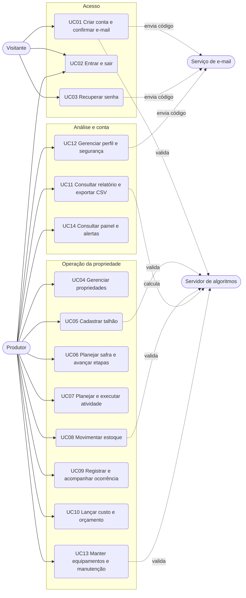

# Casos de uso do AgroGestão

Este documento registra os principais fluxos de uso do sistema. Todos os casos
descrevem comportamento que existe no código, com as regras vindas do servidor
Java (`backend/api`) e do servidor de algoritmos (`backend/serversocket`). Onde
o comportamento é detalhado em outro documento, há um link relativo.

## 1. Objetivo

Mostrar, de forma rastreável, o que cada ator consegue fazer no AgroGestão, em
que condições e com quais resultados e erros. O documento serve de base para o
[manual do usuário](15-manual-do-usuario.md), para o
[contrato da API](06-contrato-api.md) e para o
[relatório de testes](10-relatorio-de-testes.md). Esses três arquivos entram na
`dev` com os PRs #306 (manual), #304 (contrato) e #305 (relatório de testes).

Escopo: **14 casos de uso** — os 12 representativos da issue #274, mais manutenção
de equipamentos (UC13) e painel com alertas (UC14). Autenticação, propriedade,
estoque e ocorrência continuam com mais profundidade, como pede a issue.

## 2. Atores

| Ator | Tipo | Papel no sistema |
|---|---|---|
| Visitante | Humano | Pessoa sem sessão. Só acessa cadastro, confirmação de e-mail, login e recuperação de senha. |
| Produtor | Humano | Usuário autenticado. Opera a propriedade ativa: culturas, talhões, safras, atividades, estoque, manutenção, ocorrências, custos, painel, relatórios e perfil. |
| Serviço de e-mail | Sistema externo | Entrega os códigos de confirmação e de redefinição de senha por SMTP. Sem SMTP configurado, o servidor imprime o código no console (modo simulado). |
| Servidor de algoritmos | Sistema interno | Processo TCP (porta 3000) que valida cadastro, senha, talhão, movimentação de estoque, campos de manutenção, agenda de preventivas e consolida o relatório de safra. A API o consulta por `ClienteDeAlgoritmos`. |

Observação: a implementação atual tem um único perfil de usuário autenticado
(o Produtor). Equipe, convites e permissões aparecem apenas como informação na
tela de Configurações e não alteram o que cada pessoa pode fazer
([docs/perfil.md](perfil.md)). Todo dado é isolado por usuário e pela propriedade
ativa da sessão.

## 3. Diagrama geral de casos de uso

Dependências entre os casos: UC05 exige UC04 (propriedade ativa) e catálogo de
culturas (UC05 A3); UC06 e UC07 exigem UC05 (talhão); UC10 pode se vincular a
UC05, UC06, UC08 (saída com atividade) e UC13 (intervenção com valor); UC11
consolida dados de UC05 a UC10; UC14 usa os mesmos dados para métricas e alertas
e segue UC02 (sessão); UC12 A1 filtra quais famílias de alerta aparecem em UC14.

## 4. Especificação dos casos de uso

### UC01 - Criar conta e confirmar e-mail

| Campo | Descrição |
|---|---|
| Ator principal | Visitante |
| Atores de apoio | Serviço de e-mail, Servidor de algoritmos |
| Objetivo | Obter uma conta com a propriedade inicial pronta para uso. |
| Pré-condições | Não possuir conta com o mesmo e-mail. |

**Fluxo principal**

1. O Visitante abre `criar-conta.html` e informa nome, e-mail, telefone, senha, confirmação, nome da propriedade, área e aceite dos termos.
2. O sistema valida os campos (e-mail válido e único, telefone `(DD) 9XXXX-XXXX`, senha com 8 ou mais caracteres, maiúscula, número e símbolo, confirmação igual, termos aceitos).
3. O sistema cria o usuário com `emailConfirmado = false` e a propriedade informada (`POST /api/auth/register`, 201).
4. O Serviço de e-mail envia um código de 6 dígitos.
5. O Visitante informa o código em `confirmar-email.html` (`POST /api/auth/confirm-email`).
6. O sistema marca o e-mail como confirmado e libera o login.

**Fluxos alternativos**

- A1 (reenvio): se o código não chegou, o Visitante pede novo envio (`POST /api/auth/resend-confirmation`). O intervalo mínimo é de 30 s; antes disso a resposta é 429 com `Retry-After`.

**Pós-condições**: usuário e propriedade persistidos; e-mail confirmado; sem sessão aberta.

**Exceções**

- E1: campo inválido, resposta 400 com `fields` por campo.
- E2: e-mail já cadastrado, resposta 409.
- E3: código inválido ou expirado, resposta 400 ("Código inválido ou expirado.").
- E4: mais de 60 tentativas por IP em um minuto, resposta 429.

### UC02 - Entrar e sair

| Campo | Descrição |
|---|---|
| Ator principal | Visitante (entrar) e Produtor (sair) |
| Objetivo | Abrir e encerrar uma sessão autenticada. |
| Pré-condições | Conta existente com e-mail confirmado. |

**Fluxo principal**

1. O Visitante informa e-mail e senha em `login.html` (`POST /api/auth/login`).
2. O sistema confere a senha (PBKDF2 com salt) e cria uma sessão Bearer válida por 12 horas.
3. O navegador guarda o token no `sessionStorage` e abre o Painel.
4. A cada tela, o sistema valida o token em `GET /api/me`, que devolve o usuário e a propriedade ativa.
5. Para sair, o Produtor confirma o modal "Sair" (`POST /api/auth/logout`, 204). O token deixa de valer.

**Fluxos alternativos**

- A1: sem token, ou com token expirado ou encerrado, as telas internas redirecionam para `login.html`.
- A2: se o logout falhar por rede, o navegador remove o token local e informa que o encerramento no servidor não foi confirmado.
- A3: após o login, se `GET /api/me` indicar `onboardingConcluido=false`, o Painel abre o tour de boas-vindas (UC14).

**Pós-condições**: sessão criada (ou encerrada). Cada conta mantém no máximo 5 sessões simultâneas.

**Exceções**

- E1: credenciais erradas, resposta 401 genérica (não revela se o e-mail existe).
- E2: e-mail ainda não confirmado, resposta 403.
- E3: limite de tentativas, resposta 429.
- E4: reiniciar o servidor derruba todas as sessões, pois ficam em memória.

### UC03 - Recuperar senha

| Campo | Descrição |
|---|---|
| Ator principal | Visitante |
| Ator de apoio | Serviço de e-mail |
| Objetivo | Definir uma nova senha quando a atual foi esquecida. |
| Pré-condições | Nenhuma. |

**Fluxo principal**

1. O Visitante informa o e-mail em `recuperar-senha.html` (`POST /api/auth/forgot-password`).
2. O sistema responde sempre 200, sem revelar se o e-mail existe, e envia um código de 6 dígitos se a conta existir.
3. O Visitante informa código, nova senha e confirmação em `redefinir-senha.html` (`POST /api/auth/reset-password`).
4. O sistema valida a senha, grava o novo hash e encerra todas as sessões abertas do usuário.

**Pós-condições**: senha trocada, sessões anteriores invalidadas. O código vale 30 minutos.

**Exceções**: E1 código inválido ou expirado (400); E2 senha fora da regra (400); E3 limite de tentativas (429).

### UC04 - Gerenciar propriedades

| Campo | Descrição |
|---|---|
| Ator principal | Produtor |
| Objetivo | Cadastrar, editar, selecionar e excluir propriedades, definindo qual está ativa. |
| Pré-condições | Sessão ativa. |

**Fluxo principal**

1. Em Configurações, o Produtor abre "Nova propriedade" e informa nome, localização, município, área e safra (`POST /api/propriedades`).
2. O sistema valida os campos no servidor e grava a propriedade com o Produtor como dono.
3. O Produtor seleciona a propriedade (`POST /api/propriedades/{id}/selecionar`). A seleção vale para o token atual e `GET /api/me` passa a devolver esse contexto.
4. O navegador recarrega e todas as telas passam a mostrar apenas os dados da propriedade ativa.

**Fluxos alternativos**

- A1: "Salvar propriedade padrão" grava a propriedade usada no próximo login (`PUT /api/perfil/propriedade-padrao`), sem mudar a sessão atual.
- A2: editar (`PUT /api/propriedades/{id}`) ou excluir (`DELETE /api/propriedades/{id}`).

**Pós-condições**: propriedade criada, alterada ou removida; contexto ativo atualizado.

**Exceções**

- E1: dados inválidos, 400 com o campo.
- E2: propriedade de outro usuário ou inexistente, 404.
- E3: exclusão recusada com 409 quando é a última propriedade, quando tem talhões, custos, estoque ou histórico, ou quando está em uso em outra sessão ativa.

### UC05 - Cadastrar talhão

| Campo | Descrição |
|---|---|
| Ator principal | Produtor |
| Ator de apoio | Servidor de algoritmos |
| Objetivo | Registrar uma área de cultivo da propriedade ativa. |
| Pré-condições | Sessão ativa, propriedade ativa e ao menos uma cultura cadastrada em Culturas (`POST /api/culturas`). |

**Fluxo principal**

1. Em Áreas de Cultivo, o Produtor informa nome, cultura, hectares e status e salva (`POST /api/talhoes`).
2. A API envia os dados ao Servidor de algoritmos, que valida e normaliza (nome até 80 caracteres, hectares maiores que zero, status válido, safra no formato `AAAA/AA`).
3. A API grava o talhão e a tela mostra o resultado e o resumo atualizado (`GET /api/talhoes/resumo`).

**Fluxos alternativos**

- A1: editar o talhão (`PUT /api/talhoes/{id}`).
- A2: cadastrar a localização no mapa (ponto ou polígono de 3 a 50 vértices) em `PUT /api/talhoes/{id}/localizacao`.
- A3 (catálogo de culturas): em Culturas, o Produtor lista o catálogo da propriedade (`GET /api/culturas`), cadastra nomes únicos (`POST /api/culturas`) ou remove entradas não usadas (`DELETE /api/culturas/{id}`). Talhões e safras só aceitam cultura já cadastrada.

**Pós-condições**: talhão disponível para safras, atividades, custos e ocorrências.

**Exceções**: E1 campo inválido, inclusive cultura que não está no catálogo (400, "Selecione uma cultura cadastrada ou inclua uma nova em Culturas."); E2 nome repetido na propriedade, sem diferenciar maiúsculas (409); E3 Servidor de algoritmos fora do ar, rotas delegadas respondem 503; E4 no catálogo (A3), cultura duplicada (409) ou exclusão com uso em talhão/safra (409).

### UC06 - Planejar safra e avançar etapas

| Campo | Descrição |
|---|---|
| Ator principal | Produtor |
| Objetivo | Criar um ciclo produtivo e conduzi-lo até a finalização. |
| Pré-condições | Ao menos um talhão cadastrado; cultura no catálogo (UC05 A3). |

**Fluxo principal**

1. Em Safras, o Produtor escolhe "Nova safra" e informa nome, cultura, início, fim e talhões (`POST /api/safras`).
2. O sistema cria a safra na etapa Planejamento.
3. O Produtor avança a etapa (`POST /api/safras/{id}/avancar`), uma por vez: Planejamento, Preparação, Plantio, Manejo, Colheita e Finalização.
4. Da etapa Plantio em diante, o Produtor pode registrar colheitas (`POST /api/colheitas`).

**Fluxos alternativos**

- A1: editar a safra (`PUT /api/safras/{id}`) ou consultar o histórico (`GET /api/safras/{id}/historico`).
- A2: excluir a safra, permitido só em Planejamento (`DELETE /api/safras/{id}`).

**Pós-condições**: histórico de etapas registrado. Safra finalizada fica só para consulta.

**Exceções**: E1 nome repetido ou talhão já em outra safra com período que se cruza (409); E2 avançar safra finalizada (409); E3 excluir safra fora de Planejamento ou com custos (409); E4 tirar da safra um talhão com custo ou colheita (409).

### UC07 - Planejar e executar atividade

| Campo | Descrição |
|---|---|
| Ator principal | Produtor |
| Objetivo | Agendar uma tarefa de campo e acompanhar sua execução. |
| Pré-condições | Ao menos um talhão cadastrado. |

**Fluxo principal**

1. Em Atividades, o Produtor cria uma atividade com nome, tipo, talhão, safra opcional, data, horário, responsável e prioridade (`POST /api/atividades`).
2. A atividade nasce com status Pendente (201) e aparece no quadro, na lista e no calendário (`GET /api/calendario`).
3. O Produtor muda o status pelo menu, pela lista ou arrastando o cartão (`POST /api/atividades/{id}/status`), seguindo a sequência Pendente, Agendada, Em andamento e Concluída. Pendente precisa ser agendada antes de iniciar.
4. O cartão só muda depois que o servidor confirma. O histórico registra cada mudança (`GET /api/atividades/{id}/historico`).

**Fluxos alternativos**

- A1: cancelar antes da conclusão (`POST /api/atividades/{id}/cancelar`).
- A2: anexar foto de evidência (`POST /api/atividades/{id}/foto`).

**Pós-condições**: atividade com histórico. Concluir uma atividade não baixa estoque nem gera custo automaticamente, e a tela não anuncia isso ([docs/atividades.md](atividades.md)).

**Exceções**: E1 campo inválido ou data fora do formato (400); E2 safra que não pertence à propriedade ou não contém o talhão (400); E3 transição de status não permitida, como iniciar uma atividade Pendente sem agendar ou reabrir estado terminal (409, "Transição de status não permitida."); E4 cancelar atividade já concluída (409).

### UC08 - Movimentar estoque

| Campo | Descrição |
|---|---|
| Ator principal | Produtor |
| Ator de apoio | Servidor de algoritmos |
| Objetivo | Manter o catálogo de insumos e o saldo corretos. |
| Pré-condições | Sessão ativa e propriedade ativa. |

**Fluxo principal**

1. Em Insumos, o Produtor cadastra um produto com nome, categoria, unidade, saldo, mínimo, limiar crítico opcional e custo unitário (`POST /api/insumos`). O saldo inicial vira um evento auditável.
2. O Produtor registra uma movimentação de entrada, saída ou ajuste (`POST /api/insumos/{id}/movimentacoes`).
3. O sistema valida a movimentação, atualiza o saldo e grava o histórico com saldo anterior e posterior.
4. O indicador do produto passa a Normal, Baixo (saldo abaixo do mínimo) ou Crítico (saldo menor ou igual ao limiar crítico).

**Fluxos alternativos**

- A1 (entrada com custo): atualiza o custo médio ponderado; sem preço, o custo anterior é mantido.
- A2 (ajuste): informa o saldo contado, pode zerar o item e exige motivo.
- A3 (saída com atividade): vincula a atividade persistida do titular e gera um custo na categoria Insumos (quantidade x custo médio).
- A4: excluir o produto só é possível com saldo zero e apenas o arquiva (`DELETE /api/insumos/{id}`).

**Pós-condições**: saldo e histórico atualizados; resumo com produtos, críticos, entradas do mês e valor em estoque (`GET /api/insumos/resumo`).

**Exceções**: E1 dado inválido (400); E2 saída com saldo insuficiente, o saldo nunca fica negativo (409); E3 excluir com saldo (409); E4 produto de outra propriedade (404).

### UC09 - Registrar e acompanhar ocorrência

| Campo | Descrição |
|---|---|
| Ator principal | Produtor |
| Objetivo | Registrar um problema de campo e acompanhá-lo até a resolução. |
| Pré-condições | Sessão ativa e propriedade ativa. |

**Fluxo principal**

1. Em Ocorrências, o Produtor escolhe "Registrar ocorrência" e informa título, tipo, talhão opcional, data, prioridade e descrição (`POST /api/ocorrencias`).
2. O sistema cria a ocorrência sempre com status aberto e versão inicial.
3. O Produtor publica atualizações na linha do tempo (`POST /api/ocorrencias/{id}/timeline`, com `acao` de acompanhamento, atualização ou resolução).
4. Ao marcar como resolvida, o servidor grava `resolvidaEm`, e o resumo mensal conta a resolução pelo mês dessa data (fuso America/Sao_Paulo).

**Fluxos alternativos**

- A1: editar os campos de cadastro, informando a `versao` esperada (`PUT /api/ocorrencias/{id}`).
- A2: excluir de forma lógica, informando a `versao` (`DELETE /api/ocorrencias/{id}`). A ficha continua consultável.
- A3: marcar a posição no mapa com `localizacao`, aceita só dentro do polígono do talhão.
- A4: anexar foto de evidência (JPEG, PNG, WebP ou GIF, até 5 MiB).

**Pós-condições**: timeline preservada; resumo com abertas, em acompanhamento, prioridade alta ativa e resolvidas no mês (`GET /api/ocorrencias/resumo`).

**Exceções**: E1 dado inválido (400); E2 versão antiga, transição inválida ou registro somente para consulta (409); E3 ocorrência de outro usuário ou propriedade (404); E4 aba aberta em outra propriedade, bloqueada pela comparação de `contextoPropriedadeId` com a sessão.

### UC10 - Lançar custo e orçamento

| Campo | Descrição |
|---|---|
| Ator principal | Produtor |
| Objetivo | Registrar custos da operação e comparar com o orçamento da safra. |
| Pré-condições | Sessão ativa. Talhão e safra são opcionais. |

**Fluxo principal**

1. Em Custos, o Produtor salva um lançamento com descrição, categoria, valor, data e vínculos opcionais (`POST /api/custos`).
2. O sistema guarda o valor em centavos e devolve também talhão, safra e cultura.
3. Os indicadores mostram total, custo por hectare, divisão por categoria, talhão, safra e evolução mensal (`GET /api/custos/resumo`).
4. O Produtor define o orçamento da safra (`PUT /api/orcamentos/{safraId}`) e acompanha o desvio e a situação (`dentro`, `proximo` ou `acima`).

**Fluxos alternativos**

- A1: consultar planejado x realizado de todas as safras (`GET /api/orcamentos`) ou de uma safra (`GET /api/orcamentos/{safraId}`).
- A2: remover o valor planejado (`DELETE /api/orcamentos/{safraId}`).

**Pós-condições**: custos e orçamento persistidos. Sem orçamento, planejado e desvio ficam nulos, sem meta inventada.

**Exceções**: E1 valor ou campo inválido (400); E2 safra finalizada, que não aceita criar, alterar ou excluir custo (409); E3 editar custo gerado por consumo de estoque ou por manutenção, que muda pela origem (409).

### UC11 - Consultar relatório e exportar CSV

| Campo | Descrição |
|---|---|
| Ator principal | Produtor |
| Ator de apoio | Servidor de algoritmos (relatório de safra) |
| Objetivo | Consolidar a operação de um período e levar o resultado para planilha. |
| Pré-condições | Sessão ativa. |

**Fluxo principal**

1. O Produtor abre o relatório pelo botão da tela: "Relatório da propriedade" no Painel, "Relatório de atividades" em Atividades, "Relatório de estoque" em Insumos ou o relatório da safra em Safras.
2. Nos relatórios por período, informa início e fim.
3. O sistema consulta a API (`GET /api/relatorios/propriedade`, `GET /api/relatorios/atividades`, `GET /api/relatorios/estoque` ou `GET /api/relatorios/safras/{id}`) e mostra o resultado.
4. O Produtor usa "Exportar CSV". O arquivo traz o mesmo resultado consultado, com BOM UTF-8 e separador `;`.

**Pós-condições**: nenhum dado é alterado.

**Exceções**: E1 período ausente ou invertido (400); E2 propriedade ativa mudou durante a consulta (409); E3 safra de outra propriedade (404); E4 falha de uma fonte interrompe o relatório, sem mostrar zero fictício.

### UC12 - Gerenciar perfil e segurança

| Campo | Descrição |
|---|---|
| Ator principal | Produtor |
| Ator de apoio | Serviço de e-mail |
| Objetivo | Manter dados pessoais, preferências e credenciais. |
| Pré-condições | Sessão ativa. |

**Fluxo principal**

1. Em Configurações, o Produtor altera nome, e-mail e telefone (`PUT /api/perfil`).
2. Ao trocar o e-mail, informa a senha atual. O novo endereço fica pendente e o atual continua válido.
3. O Serviço de e-mail envia um código; o Produtor o confirma (`POST /api/perfil/email/confirmar`), e todas as sessões são encerradas.
4. Para trocar a senha, informa a atual, a nova e a confirmação (`PUT /api/perfil/senha`). Todas as sessões são encerradas.

**Fluxos alternativos**

- A1: salvar preferências de notificação (`PUT /api/perfil/preferencias`). As chaves `stock`, `activities`, `occurrences`, `weather` e `reports` filtram o que UC14 exibe no sino (sem inventar alerta climático no MVP).
- A2: reenviar o código de e-mail, com intervalo de 30 s (`POST /api/perfil/email/reenviar`).
- A3: contas legadas sem o campo `onboardingConcluido` são tratadas como tour já concluído (`GET /api/me`); contas novas concluem com `POST /api/perfil/onboarding` (detalhes em UC14).

**Pós-condições**: dados persistidos; o usuário vem sempre da sessão, nunca de um ID enviado pelo cliente.

**Exceções**: E1 senha atual incorreta ou nova fora da regra (400); E2 e-mail já ocupado ou código reutilizado (409); E3 falha de SMTP mantém o e-mail antigo e avisa que o envio não foi confirmado.

### UC13 - Manter equipamentos e manutenção

| Campo | Descrição |
|---|---|
| Ator principal | Produtor |
| Ator de apoio | Servidor de algoritmos |
| Objetivo | Cadastrar equipamentos, programar preventivas e registrar intervenções com custo opcional. |
| Pré-condições | Sessão ativa e propriedade ativa. |

**Fluxo principal**

1. Em Manutenção, o Produtor cadastra um equipamento (`POST /api/equipamentos`) com nome único na propriedade (sem diferenciar maiúsculas).
2. O Servidor de algoritmos valida tipo, horímetro, ano e status; a API persiste o registro.
3. O Produtor programa uma preventiva (`POST /api/preventivas`) com data prevista e intervalo opcional.
4. O Produtor registra uma intervenção (`POST /api/intervencoes`), preventiva ou corretiva. Com valor informado, o sistema gera custo em **Maquinário** (UC10); sem valor, não há custo.
5. A agenda (`GET /api/preventivas`) mostra `situacao` e `diasAte` calculados no socket; o resumo da tela usa `GET /api/manutencao/resumo`.

**Fluxos alternativos**

- A1: alterar equipamento (`PUT /api/equipamentos/{id}`) ou inativar com status Inativo (não há exclusão do equipamento).
- A2: cancelar preventiva (`PUT /api/preventivas/{id}` com `status: cancelada`) ou excluir preventiva ainda não realizada (`DELETE /api/preventivas/{id}`).
- A3: intervenção ligada a preventiva programada marca a preventiva como realizada e pode gerar a próxima data pelo intervalo.
- A4: consultar histórico (`GET /api/equipamentos/{id}/historico`) ou abrir atalho `manutencao.html?equipamentoId=` a partir de Custos.

**Pós-condições**: equipamento com histórico; custo de manutenção só muda pela intervenção (não por `PUT`/`DELETE` direto em `/api/custos/{id}`).

**Exceções**: E1 campo inválido (400); E2 nome de equipamento repetido (409); E3 preventiva já realizada não pode ser alterada ou excluída (409); E4 intervenção com safra finalizada ou talhão fora da safra (409); E5 registro de outra propriedade (404); E6 custo pendente após intervenção gravada (`custoPendente: true` em 201/200, recuperável com novo `PUT` na intervenção); E7 socket indisponível (503).

Detalhes: [manutencao.md](manutencao.md).

### UC14 - Consultar painel e alertas

| Campo | Descrição |
|---|---|
| Ator principal | Produtor |
| Objetivo | Ver indicadores do Painel, concluir o tour inicial e tratar alertas operacionais do sino. |
| Pré-condições | Sessão ativa (UC02). |

**Fluxo principal**

1. O Produtor abre `dashboard.html`. Métricas e atalhos carregam da API da propriedade ativa; totais mostram `-` até a resposta.
2. Se `GET /api/me` devolver `onboardingConcluido=false`, o tour de boas-vindas abre sobre o painel (seis passos). Ao concluir ou pular, o cliente chama `POST /api/perfil/onboarding` (200) e atualiza a sessão local.
3. O sino monta alertas reais a partir de `GET /api/insumos` (estoque baixo/crítico), `GET /api/atividades` (atrasadas e do dia) e `GET /api/ocorrencias` (abertas/em acompanhamento), respeitando as preferências de UC12 A1.
4. O Produtor clica em um alerta; o sistema navega para a tela do registro (insumo, atividade ou ocorrência) e marca a leitura no cliente, com IDs estáveis por usuário e propriedade.

**Fluxos alternativos**

- A1: até 40 alertas visíveis no painel do sino (limite do cliente; sem endpoint de resumo dedicado).
- A2: após recarregar a página, a lista é regenerada da API; leituras persistem e itens órfãos são podados.

**Pós-condições**: nenhum dado operacional é alterado pelo painel ou pelo sino, exceto a flag de onboarding no UC14 passo 2.

**Exceções**: E1 falha de uma fonte de alerta: a família correspondente some ou mostra erro com "Tentar novamente"; E2 tour não bloqueia o uso se a API de onboarding falhar (mensagem de erro, tour pode ser tentado de novo).

Detalhes: [notificacoes.md](notificacoes.md).

## 5. Fluxos alternativos e exceções

Regras que valem para todos os casos:

| Situação | Comportamento | HTTP |
|---|---|---|
| Sem token, token expirado ou encerrado | A tela redireciona para o login. | 401 |
| Dados inválidos | Resposta com `error` e, quando aplicável, `fields` por campo. | 400 |
| Registro de outro usuário ou propriedade | Tratado como inexistente. | 404 |
| Conflito de regra de negócio (duplicidade, vínculo, versão, saldo, etapa) | Mensagem explicando o conflito. | 409 |
| Limite de tentativas ou intervalo de reenvio | Cabeçalho `Retry-After`. | 429 |
| Servidor de algoritmos fora do ar | Rotas delegadas falham sem gravar dados. | 503 |
| Erro inesperado | `{"error":"Erro interno do servidor."}`; o servidor continua no ar. | 500 |

Regras de interface que complementam os fluxos:

- Toast de sucesso aparece só depois da confirmação do servidor.
- Resposta antiga nunca substitui a mais nova.
- Em falha de carregamento, a tela mostra a mensagem e o botão "Tentar novamente", sem totais inventados (o valor exibido é `-` até a API responder).
- No modo `--memoria`, os dados desaparecem ao desligar o servidor.

## Referências

- [Contrato da API](06-contrato-api.md)
- [Manual do usuário](15-manual-do-usuario.md)
- [Relatório de testes](10-relatorio-de-testes.md)
- [Documento de produto](AgroGestao_Projeto.md)
- Módulos: [atividades](atividades.md), [estoque](estoque.md), [ocorrências](ocorrencias.md), [safras](safras.md), [custos](custos.md), [orçamento](orcamento.md), [perfil](perfil.md), [manutenção](manutencao.md), [notificações](notificacoes.md), [georreferenciamento](georreferenciamento.md)
