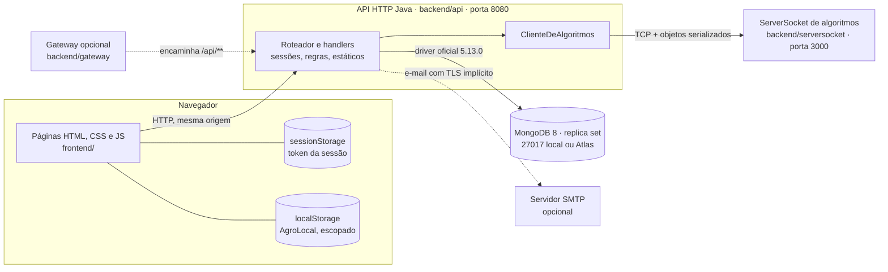
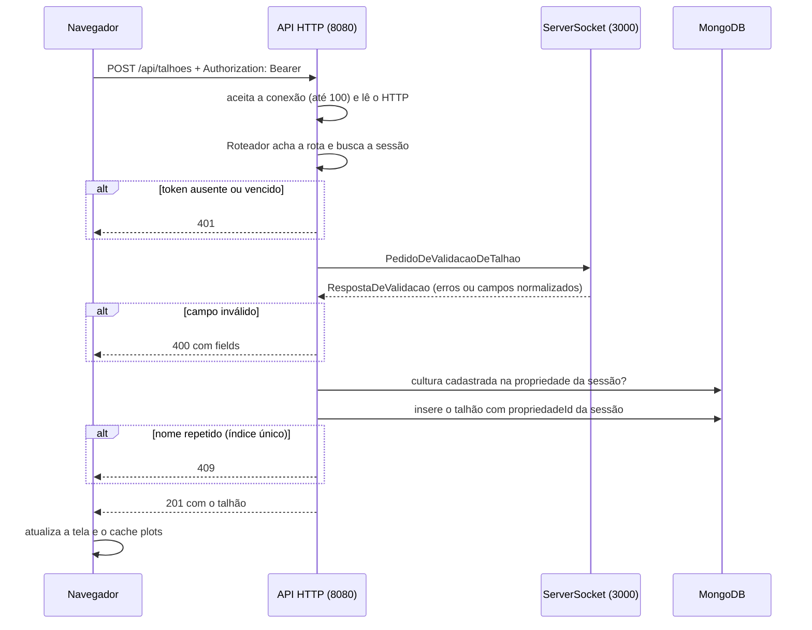

<!-- Autor principal: Pedro André do Carmo Chavier - RA: 25018639 -->

# Arquitetura do AgroGestão

| Campo | Valor |
| --- | --- |
| Documento | Arquitetura real do sistema: componentes, responsabilidades e comunicação |
| Projeto | [PI_IV_TIME_8 · Project nº 3](https://github.com/users/solerpedroo/projects/3) — Sprint 3, issue #277 |
| Versão | 1.0 — 15/11/2026 |
| Base de código conferida | branch `dev` em `e80f08f` |
| Documentos relacionados | [Requisitos](02-requisitos.md), [Contrato da API](06-contrato-api.md), [Dicionário de dados](05-dicionario-de-dados.md), [Rastreabilidade](13-rastreabilidade.md), [Relatório de testes](10-relatorio-de-testes.md) |

## Sumário

1. [Visão arquitetural](#1-visão-arquitetural)
2. [Componentes e responsabilidades](#2-componentes-e-responsabilidades)
3. [Frontend](#3-frontend)
4. [API HTTP Java](#4-api-http-java)
5. [ServerSocket e algoritmos](#5-serversocket-e-algoritmos)
6. [Persistência e MongoDB](#6-persistência-e-mongodb)
7. [Gateway opcional](#7-gateway-opcional)
8. [Fluxo de uma requisição](#8-fluxo-de-uma-requisição)
9. [Segurança e isolamento de dados](#9-segurança-e-isolamento-de-dados)
10. [Decisões e limitações](#10-decisões-e-limitações)

---

## 1. Visão arquitetural

O AgroGestão é uma aplicação web cliente–servidor com três peças obrigatórias e
uma opcional:

- o **frontend** estático (HTML, CSS e JavaScript), que roda no navegador;
- a **API HTTP Java** (`backend/api`, porta **8080**), que entrega o frontend e
  as rotas `/api/**`, controla sessões, aplica as regras que dependem do banco e
  grava no MongoDB;
- o **ServerSocket de algoritmos** (`backend/serversocket`, porta **3000**), que
  recebe dados da API, valida ou calcula e devolve o resultado, sem acesso a
  banco nem a HTTP;
- o **MongoDB Atlas**, que guarda os dados de negócio via `MONGODB_URI`;
- o **gateway** (`backend/gateway`), um proxy Java **opcional** para `/api/**`,
  que não faz parte do caminho usado pela interface.

O navegador fala somente com a API. No caminho usado pela interface, só a API
fala com o banco e com o ServerSocket. Essa divisão segue a arquitetura pedida na disciplina:
Front ↔ API ↔ MongoDB, e API ↔ ServerSocket (Java).

### 1.1 Diagrama de componentes



Linhas tracejadas indicam partes opcionais: sem SMTP, os códigos de e-mail são
impressos no console da API; o gateway só existe quando alguém o inicia.

### 1.2 Portas

| Porta | Processo | Quando se aplica |
| --- | --- | --- |
| **8080** | API HTTP (`backend/api`) | Sempre. Configurável por argumento ou `SERVIDOR_PORT`. É a porta aberta no navegador. |
| **3000** | ServerSocket de algoritmos | Sempre. `emular.sh` / `rodar.sh` / `rodar.bat` sobem o socket antes da API. Configurável por `SERVIDOR_ALGORITMOS_PORT`. |
| **Atlas** | MongoDB na nuvem (`MONGODB_URI`) | Persistência única do projeto; porta e host vêm do cluster. Sem banco (`--memoria`), não se aplica. |
| 30100 | ServerSocket de teste | Só em `backend/api/testar.sh`, para não colidir com um socket na 3000. |
| 8081 | `backend/core` | Só ao executar o `CoreApplication` (`JAVA_PORT`). |
| livre, ex.: 8082 | Gateway | Só se o gateway for iniciado; ver [§7](#7-gateway-opcional). |

API, ServerSocket e gateway escutam em `127.0.0.1` por padrão.

---

## 2. Componentes e responsabilidades

| Componente | Pasta | Responsável por | Não faz |
| --- | --- | --- | --- |
| Frontend | [`frontend/`](../frontend/) | Telas, formulários, validação imediata para o usuário, exibição dos dados, guarda do token e de caches de leitura | Não decide regra de negócio nem confirma gravação por conta própria |
| API HTTP | [`backend/api/`](../backend/api/) | HTTP feito à mão, rotas `/api/**`, arquivos estáticos, autenticação e sessões, autorização por propriedade, regras que dependem do banco (unicidade, vínculos, saldo atual), transações e e-mail | Não executa os algoritmos delegados (validações e cálculos do ServerSocket) |
| ServerSocket | [`backend/serversocket/`](../backend/serversocket/) | Validações de campo e cálculos puros: cadastro, senha, talhão, geometria, estoque, relatório de safra, manutenção | Não tem HTTP, rotas, banco, sessão nem estado entre pedidos |
| MongoDB | Atlas (`docs/mongodb-atlas.md`) | Persistência dos dados de negócio, índices únicos, transações | Não tem chave estrangeira; a integridade entre coleções é garantida pela API |
| Gateway | [`backend/gateway/`](../backend/gateway/) | Proxy opcional de `/api/**` com `/health` e `/ready` próprios | Não serve as páginas e não é usado pela interface |
| Núcleo de modelo | [`backend/core/`](../backend/core/) | Modelo de domínio (#100–#105), validação do Atlas, `/health` e `/ready` (Maven) | Não atende o frontend nem publica as rotas de negócio |

A camada de testes fica em `backend/api/teste/`, `backend/serversocket/src/test/`,
`backend/core/src/test/`, `backend/gateway/teste/` e [`tests/`](../tests/), e é
executada pelos workflows em `.github/workflows/`. A organização dos testes por
camada aparece na [§10.3](#103-testes-por-camada).

---

## 3. Frontend

### 3.1 Estrutura

O frontend é HTML, CSS e JavaScript sem framework SPA nem etapa de build. Cada
tela é uma página própria em `frontend/` (por exemplo `dashboard.html`,
`areas-cultivo.html`, `atividades.html`, `insumos.html`, `custos.html`) e carrega
os scripts de que precisa por `<script src>`.

| Pasta | Conteúdo |
| --- | --- |
| `frontend/*.html` | Telas de autenticação (`login`, `criar-conta`, `confirmar-email`, `recuperar-senha`, `redefinir-senha`, `equipe-convite`) e telas operacionais |
| `frontend/scripts/` | Um script por módulo (`atividades.js`, `insumos.js`, `custos.js`…), clientes de API (`talhoes-api.js`, `propriedades-api.js`, `perfil-api.js`), chrome do aplicativo (`shell.js`), autenticação (`auth.js`) e persistência local (`agro-local.js`) |
| `frontend/styles/` | Design system Forest Sage (`base.css`, `shell.css`, `modules.css`…) e um CSS por tela |
| `frontend/partials/` | Sidebar compartilhada |
| `frontend/Assets/` | Imagens, marca e fontes Geist locais |

### 3.2 Comunicação com a API

- As páginas são servidas pela própria API, por isso as chamadas usam
  `window.location.origin` como base: interface e API ficam na **mesma origem**.
- Depois do login, o token Bearer fica no **`sessionStorage`** da aba. As
  chamadas autenticadas enviam `Authorization: Bearer <token>`, e cada tela
  valida a sessão em `GET /api/me`.
- `fetch-timeout.js` garante `AbortSignal.timeout` nos navegadores que não o
  têm; os clientes de API usam tempo limite nas requisições.
- `shell.js` monta a navegação, preenche usuário e propriedade, aplica as
  permissões de tela de colaboradores e trata o logout.
- `propriedades-contexto.js` lista as propriedades (próprias e de colaboração) e
  troca a propriedade ativa por `POST /api/propriedades/{id}/selecionar`.

Servir `frontend/` por outro servidor estático (por exemplo
`python -m http.server 5500`) serve só para inspecionar o layout: fluxos
autenticados e persistentes exigem a API na mesma origem
([README](../README.md#4-frontend-estático-opcional-sem-api)).

### 3.3 Persistência local de apoio

`frontend/scripts/agro-local.js` expõe o `AgroLocal`, que grava em
`localStorage` com chaves no formato:

```text
agro.operational.v1.<usuarioId>.<propriedadeId>.<chave>
```

O escopo vem do usuário e da propriedade gravados na sessão da aba. Sem sessão
com propriedade, o `AgroLocal` não monta a chave; se a propriedade da sessão
mudar com a página aberta, leitura e gravação são recusadas até a página ser
recarregada. Assim, um navegador usado por duas contas, ou por uma conta com duas
propriedades, não mistura os dados.

No código atual o `AgroLocal` guarda:

| Chave | Uso | Gravada por |
| --- | --- | --- |
| `plots` | Cópia de leitura da lista de talhões devolvida pela API | `talhoes-api.js`, `areas-cultivo.js` |
| `activities` | Cópia de leitura das atividades devolvidas pela API | `atividades.js` |
| `notifications` | IDs dos alertas já lidos | `notificacoes.js` |
| `costs` | Período escolhido na tela de Custos (lançamentos e orçamento vêm da API) | `custos.js` |

Chaves antigas sem dono (`stock`, `occurrences`, `settings` e registros
`agro.operational.v1.*` sem escopo) ficam intactas, mas não são lidas nem
importadas: não há como saber a qual conta pertencem. Os detalhes estão em
[persistencia-local.md](persistencia-local.md).

> **A API é a fonte de verdade.** Com sessão autenticada, toda criação,
> edição ou exclusão só é anunciada depois da resposta da API. Uma falha de rede
> não confirma a mutação no `localStorage`, e o cache local nunca substitui uma
> consulta que falhou por dados antigos ou de demonstração (RNF-009 e RNF-010 em
> [02-requisitos.md](02-requisitos.md#42-confiabilidade-e-consistência)). O
> armazenamento local é apoio de leitura e de conveniência, escopado por
> usuário e propriedade, e não sincroniza dispositivos.

---

## 4. API HTTP Java

### 4.1 Papel

`backend/api` é o ponto de entrada do sistema. O código Java está agrupado por
módulo funcional (`handlers/cultivo`, `dados/estoque`, etc.); mapa em
[backend/ESTRUTURA.md](../backend/ESTRUTURA.md) e [backend/api/MODULOS.md](../backend/api/MODULOS.md).
É Java 21 puro: o HTTP é lido e
escrito à mão sobre `java.net.ServerSocket`/`Socket`, sem `HttpServer`, Spring ou
Netty. A única biblioteca externa é o driver oficial do MongoDB 5.13.0
(`backend/api/lib/`). Os scripts `compilar`, `rodar` e `testar` dispensam Maven.

O mesmo processo entrega:

- os **arquivos do frontend** (pasta definida por `SERVIDOR_RAIZ`, padrão
  `../../frontend`; `/` redireciona para `/login.html`);
- a **API** em `/api/**`;
- **`/health`** (processo no ar), **`/ready`** (processo e banco) e
  **`/actuator/health`** (compatibilidade usada pelo gateway).

O catálogo das rotas está no [contrato da API](06-contrato-api.md); o desenho
interno do HTTP manual, em [servidor-java.md](servidor-java.md).

### 4.2 Camadas

| Camada | Pacote | Classes principais | Responsabilidade |
| --- | --- | --- | --- |
| Rede e threads | (padrão) | `Servidor`, `AceitadoraDeConexao`, `SupervisoraDeConexao` | Abrir a porta, aceitar conexões com limite de 100 (`Semaphore`), uma thread por conexão, encerramento pelo comando `desativar` |
| Protocolo HTTP | `http` | `ParceiroHttp`, `Requisicao`, `Resposta`, `Roteador`, `ErroHttp` | Ler e escrever HTTP/1.x, rotear por método e padrão, exigir token, CORS |
| Casos de uso | `handlers` | `AuthHandler`, `PropriedadesHandler`, `TalhoesHandler`, `SafrasHandler`, `AtividadesHandler`, `EstoqueHandler`, `OcorrenciasHandler`, `CustosHandler`, `ManutencaoHandler`, `EquipeHandler`, `Relatorio*Handler`, `EstaticosHandler`, `SaudeHandler`… | Regras de cada módulo, sempre com a propriedade da sessão |
| Serviços | `servicos` | `ClienteDeAlgoritmos`, `AlgoritmosDeGeo`, `AlgoritmosDeManutencao`, `CustosDeConsumo`, `CustosDeManutencao`, `RelatorioSafra`, `ServicoEmail` | Ponte com o ServerSocket, custos gerados por outros módulos, e-mail |
| Dados | `dados` | `Repositorio*` (interface), `Repositorio*Mongo`, `Repositorio*Memoria`, `ConexaoMongo` | Acesso ao banco; a versão em memória atende testes e o modo `--memoria` |
| Segurança | `seguranca` | `Senhas`, `Sessoes`, `Sessao`, `LimitadorDeTaxa` | Hash de senha, sessões, limite de tentativas |
| Utilitários | `util` | `Json`, `Validacao`, `PapelNaPropriedade`, `TelasAcesso`… | JSON com `org.bson.Document`, erros por campo, papéis da equipe |

`Servidor.montarRoteador` monta todos os handlers e repositórios uma vez, antes
de abrir a porta. Com `--memoria`, cada repositório é a implementação em
memória; sem a opção, a implementação Mongo.

### 4.3 Modos de execução

| Modo | Comando | Banco | Uso |
| --- | --- | --- | --- |
| Com MongoDB | `bash emular.sh` (raiz) ou `bash backend/api/rodar.sh` | `MONGODB_URI` no `.env` na raiz (Atlas) | Uso normal, com persistência |
| Memória | `bash backend/api/rodar.sh --memoria` | nenhum | Desenvolvimento e testes; os dados somem ao encerrar |
| Sem ServerSocket | `SERVIDOR_ALGORITMOS_DISABLED=1 bash rodar.sh …` | conforme o modo | Não recomendado: as rotas delegadas respondem 503 |

Se o MongoDB estiver fora do ar na partida, a API não sobe (`MongoDB
indisponivel`), porque já cria os índices ao iniciar. Se o banco cair depois,
`/ready` passa a responder 503. As variáveis de configuração estão em
[backend/api/README.md](../backend/api/README.md#configuração).

---

## 5. ServerSocket e algoritmos

### 5.1 Papel

`backend/serversocket` é o servidor de **algoritmos** exigido pela disciplina. Só
usa o JDK 21, sem biblioteca externa e sem JSON. Ele recebe um pedido da API,
executa uma função pura e devolve uma resposta. Não grava nada, não guarda estado
entre pedidos e não conhece banco, sessão ou HTTP.

| Classe | Papel |
| --- | --- |
| `Servidor`, `AceitadoraDeConexao`, `SupervisoraDeConexao` | Porta 3000, limite de 100 conexões, uma thread por conexão, encerramento com `desativar` |
| `Atendente` | Despacha cada `Pedido` para o algoritmo correspondente, sem estado e sem E/S |
| `algoritmos/` | `ValidadorDeConta`, `ValidadorDeTalhao`, `CalculadoraDeTalhoes`, `GeometriaDeTalhao`, `CalculadoraDeEstoque`, `ConsolidadorDeSafra`, `ValidadorDeManutencao`, `AgendaDeManutencao`, `PeriodoSafra`, `Validacao` |
| `protocolo/` | Mensagens, `Parceiro` (socket e streams), `Cliente` (lado da API), `FiltroDeClasses`, `LimiteDeLeitura` |

### 5.2 Protocolo

Protocolo próprio, com objetos `Comunicado` serializados por
`ObjectOutputStream`/`ObjectInputStream` sobre TCP:

1. A API conecta e o servidor fala primeiro com `ComunicadoDeBoasVindas`
   (ou `RespostaDeErro SERVIDOR_LOTADO`, e fecha).
2. A API envia um `Pedido` com `id` e espera **uma** `Resposta` com o mesmo
   `idDoPedido`. A mesma conexão atende vários pedidos, um por vez.
3. A conversa termina com `PedidoParaSair`. No desligamento, o servidor avisa com
   `ComunicadoDeDesligamento`. Conexão sem pedido por 5 minutos é fechada.

Erro de **validação** não é falha: volta como `RespostaDeValidacao` com os erros
por campo (as chaves são os `name` dos formulários). Falha do **servidor** volta
como `RespostaDeErro` com código (`PEDIDO_INVALIDO`, `DADOS_INCONSISTENTES`,
`SERVIDOR_LOTADO`, `ERRO_INTERNO`…). A tabela completa de mensagens e códigos
está em [backend/serversocket/README.md](../backend/serversocket/README.md#protocolo).

### 5.3 O que a API delega

| Assunto | Pedido | Usado pela API em |
| --- | --- | --- |
| Conta | `PedidoDeValidacaoDeCadastro`, `PedidoDeValidacaoDeSenha` | Cadastro, redefinição de senha, troca de senha no perfil |
| Talhões | `PedidoDeValidacaoDeTalhao`, `PedidoDeResumoDeTalhoes` | `POST`/`PUT /api/talhoes`, `GET /api/talhoes/resumo` |
| Georreferenciamento | `PedidoDeValidacaoDeLocalizacao`, `PedidoDePontoNoTalhao`, `PedidoDeGeometriaDoMapa` | Localização do talhão, ponto da ocorrência, `GET /api/mapa` |
| Estoque | `PedidoDeMovimentacaoDeEstoque` | `POST /api/insumos/{id}/movimentacoes` (novo saldo e custo médio) |
| Safra | `PedidoDeRelatorioDeSafra` | `GET /api/relatorios/safras/{id}` |
| Manutenção | `PedidoDeValidacaoDeEquipamento`, `…DePreventiva`, `…DeIntervencao`, `PedidoDeAgendaDeManutencao`, `PedidoDeProximaPreventiva` | Rotas de equipamentos, preventivas e intervenções |

Fica **na API** tudo o que depende do banco: e-mail já cadastrado, nome de
talhão único, cultura cadastrada, vínculos entre registros, saldo atual no
momento da gravação e transações. No estoque, por exemplo, o socket calcula o
novo saldo a partir do saldo enviado, e a API só grava se o saldo no banco ainda
for aquele.

### 5.4 Como a API se conecta

- A API compila as classes de `backend/serversocket/src/protocolo/` junto com o
  próprio código (`backend/api/compilar.sh`). Os dois lados usam o mesmo pacote
  `protocolo`, exigido pela serialização Java e pelo `FiltroDeClasses`.
- `servicos/ClienteDeAlgoritmos` mantém **um** `protocolo.Cliente` por processo,
  configurado por `SERVIDOR_ALGORITMOS_HOST` (`127.0.0.1`),
  `SERVIDOR_ALGORITMOS_PORT` (`3000`) e `SERVIDOR_ALGORITMOS_TIMEOUT_MS` (`5000`).
- Em falha de comunicação, a conexão é descartada e recriada na próxima chamada,
  e a rota responde **503** "Servidor de algoritmos indisponível".
- `backend/api/rodar.sh` compila e sobe o socket em segundo plano antes da API
  (`iniciar-algoritmos.sh`) e o encerra junto. O `rodar.bat` só inicia a API:
  no Windows sem Git Bash, o socket precisa estar no ar antes
  (`backend/serversocket/compilar.bat` e `rodar.bat`).

---

## 6. Persistência e MongoDB

### 6.1 Banco

| Ambiente | Como sobe | Observação |
| --- | --- | --- |
| MongoDB Atlas | `.env` na raiz com `MONGODB_URI` | Cluster compartilhado; bancos `agrogestao_dev` e `*_teste` conforme [mongodb-atlas.md](mongodb-atlas.md) |
| Atlas | URI individual no `.env` local | Ver [mongodb-atlas.md](mongodb-atlas.md). O `.env` não é carregado automaticamente e não entra no Git |
| Testes | bancos com nome terminado em `_teste` | As suítes `--mongo` e os scripts de schema exigem esse sufixo e limpam só o banco de teste |

O replica set é obrigatório porque a API usa **transações** em cadastro de conta,
exclusão de propriedade, movimentação de estoque, ocorrência com timeline e
atividade com histórico. `ConexaoMongo` mantém um único `MongoClient`
(thread-safe, com pool próprio) para o processo.

### 6.2 Coleções e regras

Os repositórios da API usam 19 coleções: `usuarios`, `propriedades`, `equipe_membros`,
`talhoes`, `historicos_talhoes`, `culturas`, `safras`, `colheitas`, `atividades`,
`atividades_historico`, `insumos`, `movimentacoes_insumos`, `ocorrencias`,
`ocorrencias_timeline`, `custos`, `orcamentos`, `equipamentos`, `preventivas` e
`intervencoes`. Campos, domínios e índices estão no
[dicionário de dados](05-dicionario-de-dados.md), que ainda não descreve
`equipe_membros` (a gestão de equipe entrou depois; ver
[13-rastreabilidade.md](13-rastreabilidade.md#43-implementado-sem-requisito-correspondente)).

- Toda coleção operacional carrega `propriedadeId`; os repositórios incluem a
  propriedade da sessão em todo filtro.
- Índices únicos garantem as regras de unicidade sob concorrência (e-mail, nome
  de talhão, safra e equipamento por propriedade, um orçamento por safra, um
  custo por movimentação ou intervenção). A violação vira 409.
- Não há chave estrangeira: a API confere as referências cruzadas (talhão na
  safra, safra no custo, talhão na colheita) dentro da mesma propriedade antes de
  gravar.
- Validadores `$jsonSchema` opcionais, com `validationLevel: moderate`, ficam em
  `backend/mongo-schema/` e são aplicados à mão com `mongosh`
  (`aplicar-schema.sh`); a API não depende deles para funcionar.

### 6.3 O que não fica no banco

| Dado | Onde fica | Consequência |
| --- | --- | --- |
| Sessões e tokens | Memória da API (`Sessoes`) | Reiniciar a API encerra todas as sessões |
| Token no navegador | `sessionStorage` da aba | Fechar a aba descarta o token |
| Caches de leitura e estado de tela | `localStorage`, via `AgroLocal` ([§3.3](#33-persistência-local-de-apoio)) | Conveniência; não é dado de negócio |

---

## 7. Gateway opcional

`backend/gateway` é um proxy Java **opcional**. A interface não depende dele: as
páginas e a API continuam na porta 8080, e o navegador fala direto com a API.

| Aspecto | Comportamento no código |
| --- | --- |
| Implementação | `com.sun.net.httpserver.HttpServer` do JDK, com 10 threads (diferente da API, que implementa o HTTP à mão) |
| Rotas | `GET /health` e `GET /ready` próprios; somente `/api/**` é encaminhado. Qualquer outro caminho responde 404, para o gateway não virar proxy aberto |
| Encaminhamento | Preserva método, query, corpo e autenticação; corpo até 1 MiB (413 acima disso) |
| Falhas do destino | Tempo limite de 2 s: 504 por timeout, 502 por erro de conexão |
| Prontidão | `/ready` consulta `/actuator/health` do destino |
| Configuração | `GATEWAY_HOST` (`127.0.0.1`), `GATEWAY_PORT` (`8080`), `JAVA_BASE_URL` (`http://127.0.0.1:8081`) |

Os padrões de porta do gateway colidem com a API, então ele precisa ser iniciado
com outra porta e apontado para a 8080:

```bash
cd backend/gateway
bash compilar.sh
GATEWAY_PORT=8082 JAVA_BASE_URL=http://127.0.0.1:8080 bash rodar.sh
```

A suíte `backend/gateway/teste/TesteGateway.java` usa um destino falso e roda no
workflow `gateway-testes.yml`.

---

## 8. Fluxo de uma requisição

Exemplo: cadastro de um talhão pela tela Áreas de Cultivo (`POST /api/talhoes`).



1. **Navegador.** A tela envia o formulário com `fetch` para a mesma origem, com
   o token Bearer do `sessionStorage`.
2. **Conexão.** `AceitadoraDeConexao` reserva uma das 100 vagas (sem vaga, 503
   imediato) e cria uma `SupervisoraDeConexao`. `ParceiroHttp` lê a requisição
   com limite de cabeçalho (16 KB), corpo (1 MB) e tempo (10 s).
3. **Roteamento e sessão.** `Roteador` casa método e padrão. Para rota
   protegida, busca a sessão pelo token; sem sessão válida, 401.
4. **Contexto.** `TalhoesHandler` confere que a propriedade ativa não mudou desde
   a leitura da sessão (senão, 409 "A propriedade ativa mudou").
5. **Validação no socket.** A API envia `PedidoDeValidacaoDeTalhao`; com erro de
   campo, devolve 400 com `fields`. Socket fora do ar: 503.
6. **Regras do banco.** A API confere a cultura na propriedade e grava o talhão
   com o `propriedadeId` da sessão (nunca um valor vindo do cliente). Nome
   repetido viola o índice único e vira 409.
7. **Resposta.** A API responde JSON com `Connection: close` e
   `X-Content-Type-Options: nosniff`, fecha o socket e libera a vaga.
8. **Tela.** Só depois do 201 a tela anuncia sucesso e atualiza a lista; a cópia
   `plots` no `AgroLocal` é regravada a partir das listagens da API.

Rotas que não delegam ao socket seguem o mesmo caminho, sem o passo 5. Arquivos
estáticos não exigem token e passam pelo `EstaticosHandler`.

---

## 9. Segurança e isolamento de dados

### 9.1 Autenticação e sessão

| Ponto | Implementação |
| --- | --- |
| Senha | PBKDF2WithHmacSHA256, 120.000 iterações, salt aleatório (`seguranca/Senhas`). Hash e tokens nunca saem nas respostas |
| Cadastro e e-mail | A conta nasce com e-mail não confirmado; o login só cria sessão depois da confirmação. Códigos por SMTP ou, sem SMTP, no console |
| Token | UUID em memória (`seguranca/Sessoes`), válido por 12 horas, no máximo 5 sessões por conta (a mais antiga cai) |
| Encerramento | Logout, troca ou redefinição de senha e confirmação de novo e-mail encerram as sessões |
| Rotas públicas | `/api/auth/*`, `GET /api/equipe/convite`, `/health`, `/ready`, `/actuator/health` e os estáticos. O resto de `/api/**` exige token; rota inexistente sem token responde 401, sem revelar quais existem |
| Enumeração | Login devolve o mesmo 401 para e-mail inexistente e senha errada; `forgot-password` sempre responde 200 |
| Limite de tentativas | 60 por IP por minuto nas rotas públicas sensíveis e 20 por conta por minuto nas operações de perfil (429 com `Retry-After`) |

### 9.2 Isolamento por usuário e propriedade

- A sessão guarda `usuarioId` e a **propriedade ativa**. Todo handler usa esses
  valores da sessão, não do corpo da requisição.
- Registro de outra propriedade responde **404**, como se não existisse.
- A troca de propriedade (`POST /api/propriedades/{id}/selecionar`) só é aceita
  para o dono ou para um colaborador com vínculo ativo em `equipe_membros`.
- O cache local segue o mesmo isolamento, pela chave com usuário e propriedade
  ([§3.3](#33-persistência-local-de-apoio)).

### 9.3 Proteção do servidor

| Ameaça | Medida |
| --- | --- |
| Leitura de arquivos do servidor | Estáticos só com extensões permitidas (html, css, js, jpg, png, svg, ico, woff2); `..`, arquivos iniciados por ponto (`.env`, `.git`) e `backend/` bloqueados |
| Esgotamento de recursos | 100 conexões, cabeçalho 16 KB, corpo 1 MB (8 MiB só no upload de foto), timeout 10 s; no socket, 1 MiB por mensagem e 100 conexões |
| Desserialização no socket | `FiltroDeClasses` aceita só classes `protocolo.*` e tipos simples, com limite de profundidade e de tamanho de listas |
| Origem cruzada | CORS só para `localhost` e `127.0.0.1`; `nosniff` em todas as respostas |
| Vazamento de erro | Exceção vira `500 {"error":"Erro interno do servidor."}`; o detalhe fica no log |
| Credenciais | URI do banco e SMTP só em variáveis de ambiente ou `.env` local, fora do Git |

As verificações correspondentes são RNF-001 a RNF-008 em
[02-requisitos.md](02-requisitos.md#41-segurança).

---

## 10. Decisões e limitações

### 10.1 Decisões

| Decisão | Motivo |
| --- | --- |
| HTTP implementado à mão na API | Exigência da disciplina de um servidor "feito na mão"; mantém visível o parse, o roteamento e a concorrência |
| ServerSocket separado só para algoritmos | Padrão Cliente–Servidor da disciplina; separa regra pura (testável sem rede nem banco) de regra que depende do banco |
| Protocolo de objetos serializados com lista de permissão | Formato da disciplina; o filtro e os limites de leitura reduzem o risco da desserialização |
| Frontend servido pela API | Mesma origem: o navegador chama a API sem depender de CORS e com um único endereço para abrir |
| Repositórios com versão Mongo e versão memória | Suítes rápidas sem banco e modo `--memoria`; as regras numéricas são as mesmas nas duas |
| MongoDB em replica set | Transações nas operações compostas (estoque, histórico, cadastro) |
| API como fonte de verdade e cache local escopado | Evita confirmar no navegador o que o servidor recusou e impede mistura de dados entre contas |
| Gateway mantido como opcional | Proxy simples para quem quiser separar a entrada de `/api/**`, sem acoplar a interface a ele |

### 10.2 Limitações conhecidas

- **Um processo, sessões em memória.** Reiniciar a API desloga todos e não há
  suporte a várias instâncias compartilhando sessões.
- **Sem TLS.** Os servidores escutam em loopback; HTTPS depende de um proxy na
  frente. Expor o socket em rede também exigiria TLS.
- **Uma requisição por conexão.** Sem `keep-alive` e sem
  `Transfer-Encoding: chunked` (501).
- **Pedidos ao socket em série.** `ClienteDeAlgoritmos` usa uma única conexão
  com o ServerSocket, e `Cliente.chamar` é sincronizado: requisições simultâneas
  que dependem do socket esperam umas pelas outras. O README do socket sugere um
  pool de conexões, ainda não implementado.
- **Dependência do socket.** Sem o ServerSocket, as rotas delegadas respondem
  503; o restante da API continua funcionando. No Windows, `backend/api/rodar.bat`
  não sobe o socket como o `rodar.sh`, então ele precisa ser iniciado à parte.
- **Permissões de tela da equipe só na navegação.** As telas liberadas a um
  colaborador (`telas`) são aplicadas por `shell.js`, que esconde os itens e
  redireciona. No código conferido, os handlers de dados verificam a propriedade
  da sessão, não a tela.
- **Integridade entre coleções na aplicação.** Sem chave estrangeira, um id
  órfão gravado fora da API não é barrado pelo banco.
- **Dinheiro gravado em reais.** Os cálculos usam centavos, mas alguns campos são
  gravados como `double` em reais ([dicionário, §9](05-dicionario-de-dados.md#9-limitações-e-divergências-conhecidas)).
- **`backend/core` com modelo anterior.** [modelo-dados.md](modelo-dados.md)
  descreve o domínio do `core`; os formatos gravados pela API são os do
  dicionário de dados.

### 10.3 Testes por camada

| Camada | Suíte | Como roda |
| --- | --- | --- |
| Algoritmos | JUnit 5 em `backend/serversocket/src/test/java` (tags `unitario`, `contrato`, `integracao`) | `sh backend/serversocket/testar.sh` ou `mvn verify`; workflow `serversocket-testes.yml` |
| API | `backend/api/teste/Teste*.java`, sem JUnit: sobem a API real numa porta livre, com repositórios em memória, e fazem HTTP por socket | `bash backend/api/testar.sh` (sobe o socket na 30100); variantes `--mongo` exigem banco `_teste` |
| Banco | `TesteMongo`, `TesteEstoqueMongo`, `testar-mongo.sh`, `backend/core/testar.sh --atlas`, `backend/mongo-schema/testar-schema.sh` | MongoDB local ou Atlas com banco `_teste` |
| Gateway | `backend/gateway/teste/TesteGateway.java` | `bash backend/gateway/testar.sh` |
| Navegador | `tests/*-real.cjs` (Playwright, com a API em `--memoria` e o socket na 3000) e `tests/local-*.cjs` (sem backend) | `node tests/<arquivo>.cjs`; workflows por módulo |

Os resultados das execuções estão no [relatório de testes](10-relatorio-de-testes.md)
e na [matriz de rastreabilidade](13-rastreabilidade.md), com as evidências em
[`docs/evidencias/testes/`](evidencias/testes/).
