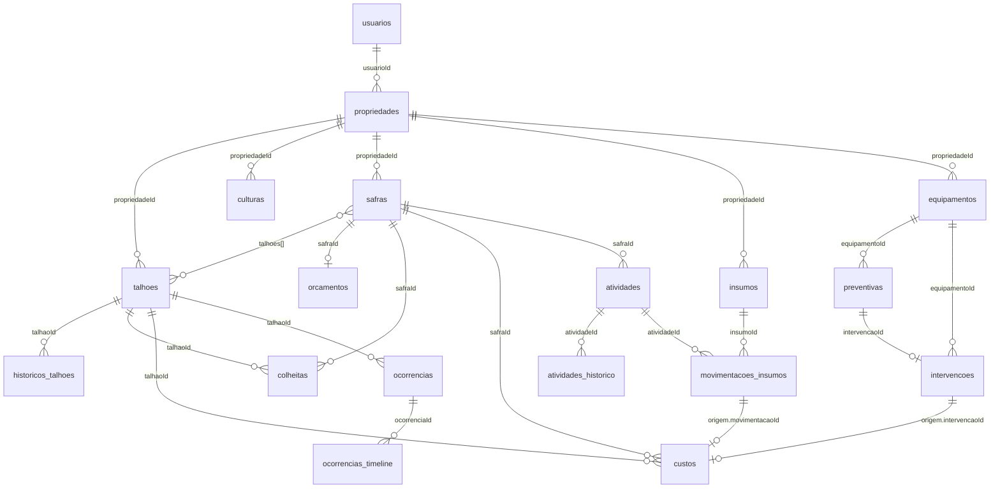

# Dicionário de dados

Descreve as coleções MongoDB que a API Java (`backend/api`) lê e grava, campo a campo. O conteúdo foi conferido nos repositórios `Repositorio*Mongo`, nos handlers e nos validadores do ServerSocket. Onde o código e documentos antigos divergem, vale o código.

## 1. Objetivo e convenções

| Convenção | Significado |
|---|---|
| Tipo `string` | texto UTF-8, sempre com limite de tamanho validado na API |
| Tipo `ObjectId` | identificador `_id` gerado pelo MongoDB; na API sai como `id` (texto hexadecimal de 24 caracteres) |
| Tipo `double` | número decimal (BSON double) |
| Tipo `data ISO` | texto `AAAA-MM-DD`, sem fuso |
| Tipo `instante ISO` | texto UTC gerado por `Instant.now().toString()`, por exemplo `2026-11-13T14:00:00Z` |
| Obrigatório `sim` | a API recusa o cadastro sem o campo |
| Obrigatório `não` | pode faltar ou ser `null` |
| Obrigatório `sistema` | gravado pelo servidor; o cliente não escolhe |

Regras que valem para todas as coleções operacionais:

- O cliente nunca informa `_id`, `propriedadeId` nem `usuarioId`. O servidor grava esses campos a partir da sessão autenticada.
- Toda consulta e toda gravação filtram pela propriedade ativa da sessão (seção 7).
- Validações de texto, número e data ficam no Java: nos handlers da API e, para conta, talhão e manutenção, no ServerSocket (porta 3000).
- Os campos `nomeNormalizado` guardam o nome em minúsculas e servem só para unicidade e busca. A API não os devolve.
- Valores em dinheiro **não** estão em centavos neste código: `custos.value`, `orcamentos.valor`, `intervencoes.valor` e `insumos.custoUnitario` são `double` em reais, arredondados a 2 casas nos custos e orçamentos. Os cálculos de centavos acontecem em memória, antes da gravação. Ver [seção 9](#9-limitações-e-divergências-conhecidas).

## 2. Visão geral das coleções

| Coleção | Finalidade | Repositório |
|---|---|---|
| `usuarios` | conta do produtor, credenciais, confirmações e preferências | `RepositorioUsuariosMongo` |
| `propriedades` | fazendas do produtor | `RepositorioUsuariosMongo` |
| `talhoes` | áreas de cultivo da propriedade | `RepositorioTalhoesMongo` |
| `historicos_talhoes` | eventos que apontam para um talhão | `RepositorioTalhoesMongo` |
| `culturas` | catálogo de culturas por propriedade | `RepositorioCulturasMongo` |
| `safras` | ciclos de cultivo com etapas | `RepositorioSafrasMongo` |
| `atividades` | tarefas de campo planejadas e executadas | `RepositorioAtividadesMongo` |
| `atividades_historico` | trilha de eventos de cada atividade | `RepositorioAtividadesMongo` |
| `insumos` | catálogo e saldo do estoque | `RepositorioEstoqueMongo` |
| `movimentacoes_insumos` | entradas, saídas e ajustes de estoque | `RepositorioEstoqueMongo` |
| `ocorrencias` | registros de problemas e eventos do campo | `RepositorioOcorrenciasMongo` |
| `ocorrencias_timeline` | versões e acompanhamentos de cada ocorrência | `RepositorioOcorrenciasMongo` |
| `custos` | lançamentos de custo, manuais ou gerados | `RepositorioCustosMongo` |
| `orcamentos` | orçamento planejado por safra | `RepositorioOrcamentosMongo` |
| `colheitas` | produção registrada por safra e talhão | `RepositorioColheitasMongo` |
| `equipamentos` | máquinas e implementos | `RepositorioEquipamentosMongo` |
| `preventivas` | agenda de manutenção preventiva | `RepositorioPreventivasMongo` |
| `intervencoes` | manutenções realizadas | `RepositorioIntervencoesMongo` |

Existem 18 coleções. No modo `--memoria` do servidor, cada repositório tem uma versão `Memoria` com a mesma estrutura de documento; este dicionário descreve o formato do MongoDB.

## 3. Diagrama de relacionamento

O MongoDB não tem chave estrangeira. Os vínculos abaixo são referências por `id` (ou, onde indicado, por nome) verificadas pela aplicação.

Vínculos por nome (não por `id`): `atividades.talhao` guarda o nome do talhão; `talhoes.cultura` e `safras.cultura` guardam o nome da cultura.

## 4. Dicionário por coleção

Os campos `_id` (ObjectId, sistema) existem em todas as coleções e não são repetidos nas tabelas.

### 4.1 `usuarios`

| Campo | Tipo | Obrig. | Descrição e regra |
|---|---|---|---|
| `name` | string | sim | nome do produtor, até 120 caracteres |
| `email` | string | sim | e-mail de login, único em toda a coleção |
| `phone` | string | sim | telefone, até 20 caracteres, formato `(DD) 9XXXX-XXXX` |
| `senhaHash` | string | sistema | hash da senha (classe `Senhas`); nunca sai pela API |
| `emailConfirmado` | boolean | sistema | `false` até o código de 6 dígitos ser confirmado |
| `tokenConfirmacao` | string | não | código de confirmação do cadastro; `null` após confirmar |
| `ultimoEnvioConfirmacao` | long | sistema | instante (ms) do último envio, para limitar reenvios |
| `tokenRedefinicao` | string | não | código de redefinição de senha |
| `redefinicaoExpiraEm` | long | não | instante (ms) em que o código de redefinição expira |
| `emailPendente` | string | não | novo e-mail aguardando confirmação |
| `tokenTrocaEmail` | string | não | código enviado ao novo e-mail |
| `trocaEmailExpiraEm` | long | não | instante (ms) de expiração da troca de e-mail |
| `ultimoEnvioTrocaEmail` | long | não | instante (ms) do último envio do código de troca |
| `propriedadeId` | string | sistema | propriedade padrão do usuário |
| `versaoPropriedades` | long | sistema | contador incrementado quando uma propriedade é excluída |
| `preferencias` | documento | não | chaves booleanas `stock`, `weather`, `activities`, `occurrences`, `reports` |
| `onboardingConcluido` | boolean | sistema | `false` no cadastro; `true` após concluir o tour |
| `onboardingConcluidoEm` | instante ISO | não | quando o tour foi concluído |
| `criadoEm` | instante ISO | sistema | criação da conta |
| `atualizadoEm` | instante ISO | não | última alteração de nome ou telefone |

Quando `preferencias` não existe, a API devolve todas como `true`, exceto `reports`, que vem `false`.

### 4.2 `propriedades`

| Campo | Tipo | Obrig. | Descrição e regra |
|---|---|---|---|
| `usuarioId` | string | sistema | dono da propriedade (id do usuário) |
| `proprietarioId` | ObjectId | sistema | mesmo dono, em `ObjectId` |
| `nome` | string | sim | nome da propriedade, até 120 caracteres, único por usuário |
| `localizacao` | string | sim | texto de localização, até 160 caracteres |
| `municipio` | string | sim | município, até 120 caracteres |
| `safraAtual` | string | sim | período no formato `AAAA/AA`, por exemplo `2026/27` |
| `areaHectares` | double | sim | área total, maior que 0 e até 100.000.000 |
| `criadaEm` | instante ISO | sistema | criação |
| `atualizadoEm` | instante ISO | sistema | última alteração |
| `farm` | string | não | campo legado do primeiro cadastro; a leitura usa como `nome` quando `nome` falta |
| `area` | string | não | campo legado de área em texto; não é convertido em número |

### 4.3 `talhoes`

| Campo | Tipo | Obrig. | Descrição e regra |
|---|---|---|---|
| `propriedadeId` | string | sistema | propriedade dona |
| `nome` | string | sim | até 80 caracteres |
| `nomeNormalizado` | string | sistema | nome em minúsculas; único por propriedade |
| `cultura` | string | sim | nome da cultura, até 40 caracteres |
| `safra` | string | sim | período `AAAA/AA` |
| `hectares` | double | sim | área, maior que 0 e até 1.000.000 |
| `status` | string | não | `Ativo` (padrão), `Irrigação pendente` ou `Em preparo` |
| `localizacao` | documento | não | geometria `ponto` ou `poligono` com lista de pontos `{lat, lng}`; validada no ServerSocket |
| `criadoEm` | instante ISO | sistema | criação |
| `atualizadoEm` | instante ISO | sistema | última alteração |

Um talhão com atividades vinculadas não pode ser renomeado.

### 4.4 `historicos_talhoes`

| Campo | Tipo | Obrig. | Descrição e regra |
|---|---|---|---|
| `propriedadeId` | string | sistema | propriedade dona |
| `talhaoId` | string | sistema | talhão de origem do evento |
| `tipo` | string | sim | `atividade`, `ocorrencia` ou `custo` |
| `descricao` | string | sim | até 240 caracteres |
| `criadoEm` | instante ISO | sistema | momento do registro |

### 4.5 `culturas`

| Campo | Tipo | Obrig. | Descrição e regra |
|---|---|---|---|
| `propriedadeId` | string | sistema | propriedade dona |
| `proprietarioId` | string | sistema | titular que criou |
| `nome` | string | sim | no mínimo 2 caracteres |
| `nomeNormalizado` | string | sistema | único por propriedade (índice `cultura_nome_por_propriedade`) |
| `criadoEm` | instante ISO | sistema | criação |

O catálogo nasce vazio; o produtor cadastra as culturas.

### 4.6 `safras`

| Campo | Tipo | Obrig. | Descrição e regra |
|---|---|---|---|
| `propriedadeId` | string | sistema | propriedade dona |
| `nome` | string | sim | até 80 caracteres |
| `nomeNormalizado` | string | sistema | único por propriedade |
| `cultura` | string | sim | nome da cultura, até 40 caracteres |
| `talhoes` | lista de string | sim | ids de talhões da propriedade, sem repetição, de 1 a 200 |
| `dataInicio` | data ISO | sim | início do ciclo |
| `dataFim` | data ISO | sim | fim; não pode ser anterior ao início |
| `etapa` | string | sistema | etapa atual (seção 5) |
| `historicoEtapas` | lista de `{etapa, em}` | sistema | cada etapa vencida com o instante ISO |
| `finalizadaEm` | instante ISO | não | preenchido ao chegar em `Finalização` |
| `criadoEm` | instante ISO | sistema | criação |
| `atualizadoEm` | instante ISO | sistema | última alteração |

Um talhão não pode estar em duas safras com períodos que se cruzam. Safra finalizada não aceita alteração.

### 4.7 `atividades`

| Campo | Tipo | Obrig. | Descrição e regra |
|---|---|---|---|
| `usuarioId` | string | sistema | usuário que criou |
| `propriedadeId` | string | sistema | propriedade dona |
| `nome` | string | sim | até 100 caracteres |
| `tipo` | string | sim | valor de `Tipos de atividade` (seção 5) |
| `talhao` | string | sim | **nome** do talhão (comparado sem diferenciar maiúsculas), até 60 caracteres |
| `data` | string | sim | data planejada, formato ISO (`2026-08-12`) ou do protótipo (`12 ago`) |
| `status` | string | sim | começa `Pendente` (padrão) ou `Agendada` |
| `responsavel` | string | não | até 100 caracteres |
| `prioridade` | string | não | `Baixa`, `Média` ou `Alta` |
| `horario` | string | não | `HH:MM` de 00:00 a 23:59 |
| `safraId` | string | não | safra vinculada; o talhão precisa pertencer a ela |
| `safra` | string | sistema | nome da safra, copiado do vínculo |
| `cultura` | string | sistema | cultura da safra, copiada do vínculo |
| `fotoEvidencia` | documento | não | foto anexada depois do cadastro (seção 4.19) |
| `versao` | long | sistema | controle de concorrência; começa em 1 |
| `criadaEm` | instante ISO | sistema | criação |

### 4.8 `atividades_historico`

| Campo | Tipo | Obrig. | Descrição e regra |
|---|---|---|---|
| `atividadeId` | string | sistema | atividade de origem |
| `propriedadeId` | string | sistema | propriedade dona |
| `ordem` | inteiro | sistema | sequência a partir de 0; único por atividade |
| `registradoEm` | instante ISO | sistema | momento do evento |
| `status` | string | sistema | status da atividade neste evento |
| `acao` | string | sistema | por exemplo `criacao` |
| `descricao` | string | sistema | texto do evento; o evento 0 é "Registro inicial da atividade" |

A atividade e o evento 0 são gravados na mesma transação.

### 4.9 `insumos`

| Campo | Tipo | Obrig. | Descrição e regra |
|---|---|---|---|
| `propriedadeId` | string | sistema | propriedade dona |
| `nome` | string | sim | até 100 caracteres |
| `categoria` | string | sim | `Herbicida`, `Fertilizante`, `Semente`, `Fungicida` ou `Inseticida` |
| `unidade` | string | sim | até 12 caracteres, por exemplo `kg` |
| `minimo` | double | sim | estoque mínimo, de 0 a 1 bilhão, até 6 casas |
| `custoUnitario` | double | não | custo médio por unidade, em reais, até 6 casas; padrão 0 |
| `limiarCritico` | double | não | não pode superar `minimo` |
| `saldo` | double | sim na criação | saldo atual; depois só muda por movimentação |
| `excluido` | boolean | não | exclusão lógica; só é permitida com saldo 0 |
| `criadoEm` | instante ISO | sistema | criação |
| `atualizadoEm` | instante ISO | sistema | última alteração |

### 4.10 `movimentacoes_insumos`

| Campo | Tipo | Obrig. | Descrição e regra |
|---|---|---|---|
| `propriedadeId` | string | sistema | propriedade dona |
| `insumoId` | string | sistema | insumo movimentado |
| `tipo` | string | sim | `entrada`, `saida` ou `ajuste` |
| `quantidade` | double | sim | positiva em entrada e saída; o ajuste usa a diferença |
| `unidade` | string | sistema | copiada do insumo |
| `saldoAnterior` | double | sistema | saldo antes da movimentação |
| `saldoPosterior` | double | sistema | saldo depois da movimentação |
| `observacao` | string | não | até 240 caracteres; obrigatória no ajuste |
| `fornecedor` | string | não | até 120 caracteres |
| `atividadeId` | string | não | só em `saida`; precisa ser atividade da propriedade |
| `atividade` | string | sistema | título da atividade vinculada, ou vazio |
| `custoUnitario` | double | não | custo da movimentação; na saída com atividade, usa o custo médio do insumo |
| `criadoEm` | instante ISO | sistema | momento da movimentação |

A saída que ultrapassa o saldo é recusada (409). O cadastro de um insumo com saldo inicial também gera um ajuste com a observação "Saldo inicial do cadastro".

### 4.11 `ocorrencias`

| Campo | Tipo | Obrig. | Descrição e regra |
|---|---|---|---|
| `usuarioId` | string | sistema | usuário que criou |
| `propriedadeId` | string | sistema | propriedade dona |
| `titulo` | string | sim | até 160 caracteres |
| `tipo` | string | sim | `Praga`, `Doença`, `Clima`, `Equipamento` ou `Outro` |
| `prioridade` | string | sim | `Baixa`, `Média` ou `Alta` |
| `data` | data ISO | sim | data da ocorrência |
| `descricao` | string | não | até 6000 caracteres |
| `talhaoId` | string | não | talhão da propriedade |
| `talhaoNome` | string | sistema | nome do talhão, copiado |
| `safra` | string | sistema | período `AAAA/AA` do talhão, copiado |
| `localizacao` | documento | não | ponto marcado; só aceito dentro do polígono do talhão |
| `status` | string | sistema | `ABERTA`, `EM_ACOMPANHAMENTO` ou `RESOLVIDA` |
| `statusInicial` | string | sistema | sempre `ABERTA` |
| `fotoEvidencia` | documento | não | foto anexada depois do cadastro (seção 4.19) |
| `criadaEm` | instante ISO | sistema | criação |
| `atualizadaEm` | instante ISO | sistema | última versão |
| `resolvidaEm` | instante ISO | não | preenchido ao resolver |
| `excluida` | boolean | sistema | exclusão lógica |
| `excluidaEm` | instante ISO | não | quando foi excluída |
| `versao` | long | sistema | começa em 1 e cresce a cada alteração |

### 4.12 `ocorrencias_timeline`

| Campo | Tipo | Obrig. | Descrição e regra |
|---|---|---|---|
| `usuarioId` | string | sistema | usuário dono |
| `propriedadeId` | string | sistema | propriedade dona |
| `ocorrenciaId` | string | sistema | ocorrência de origem |
| `ordem` | long | sistema | igual à `versao` da ocorrência; único por ocorrência |
| `data` | instante ISO | sistema | `atualizadaEm` da versão |
| `acao` | string | sistema | operação registrada (por exemplo `acompanhamento`, `atualizacao`, `resolucao`) |
| `status` | string | sistema | status da ocorrência naquela versão |
| `descricao` | string | sistema | texto do evento, até 6000 caracteres |
| `dados` | documento | sistema | cópia dos campos da ocorrência naquela versão (título, tipo, data, prioridade, descrição, talhão, safra, localização) |

### 4.13 `custos`

| Campo | Tipo | Obrig. | Descrição e regra |
|---|---|---|---|
| `propriedadeId` | string | sistema | propriedade dona |
| `description` | string | sim | até 120 caracteres |
| `category` | string | sim | `Insumos`, `Mão de Obra`, `Maquinário`, `Combustível` ou `Outros` |
| `value` | double | sim | em reais, de 0,01 até 1.000.000.000, arredondado a 2 casas |
| `date` | data ISO | sim | data do custo |
| `talhaoId` | string | não | talhão da propriedade |
| `safraId` | string | não | safra da propriedade; o talhão precisa estar nela |
| `origem` | documento | não | presente em custo gerado automaticamente |
| `criadoEm` | instante ISO | sistema | criação |
| `atualizadoEm` | instante ISO | sistema | última alteração |

Subdocumento `origem`:

| Campo | Quando | Descrição |
|---|---|---|
| `tipo` | sempre | `consumo` (saída de estoque) ou `manutencao` (intervenção de equipamento) |
| `movimentacaoId`, `insumoId`, `atividadeId`, `quantidade`, `unidade`, `custoUnitario` | `consumo` | dados da baixa de estoque que gerou o custo |
| `intervencaoId`, `equipamentoId` | manutenção | intervenção e equipamento que geraram o custo |

Custo com `origem` só muda pela operação de origem; `PUT` e `DELETE` direto respondem 409. Custo em safra finalizada não pode ser alterado.

### 4.14 `orcamentos`

| Campo | Tipo | Obrig. | Descrição e regra |
|---|---|---|---|
| `propriedadeId` | string | sistema | propriedade dona |
| `safraId` | string | sistema | safra do orçamento; um orçamento por safra |
| `valor` | double | sim | planejado, em reais, maior que 0 e até R$ 1.000.000.000,00 |
| `alerta` | inteiro | não | percentual do planejado que dispara o alerta, de 50 a 100; padrão 80 |
| `criadoEm` | instante ISO | sistema | criação |
| `atualizadoEm` | instante ISO | sistema | última alteração |

Saldo, desvio e percentual usado não são gravados: a API calcula a partir dos custos da safra.

### 4.15 `colheitas`

| Campo | Tipo | Obrig. | Descrição e regra |
|---|---|---|---|
| `propriedadeId` | string | sistema | propriedade dona |
| `safraId` | string | sim | safra da propriedade, a partir do plantio |
| `talhaoId` | string | sim | talhão que pertence à safra |
| `quantidade` | double | sim | na unidade escolhida, mínimo 0,001, 3 casas |
| `unidade` | string | sim | `kg`, `t` ou `sc` (saca de 60 kg) |
| `quantidadeKg` | double | sistema | quantidade convertida para kg |
| `data` | data ISO | sim | não pode ser futura nem anterior ao início da safra |
| `observacao` | string | não | até 200 caracteres |
| `criadoEm` | instante ISO | sistema | criação |
| `atualizadoEm` | instante ISO | sistema | última alteração |

### 4.16 `equipamentos`

| Campo | Tipo | Obrig. | Descrição e regra |
|---|---|---|---|
| `propriedadeId` | string | sistema | propriedade dona |
| `nome` | string | sim | até 80 caracteres |
| `nomeNormalizado` | string | sistema | único por propriedade |
| `tipo` | string | sim | `Trator`, `Colheitadeira`, `Pulverizador`, `Plantadeira`, `Implemento`, `Veículo` ou `Outro` |
| `marca` | string | não | texto livre com limite |
| `modelo` | string | não | texto livre com limite |
| `identificacao` | string | não | placa ou identificação |
| `ano` | inteiro | não | de 1950 até o ano atual |
| `horimetro` | double | não | de 0 a 1.000.000 horas |
| `status` | string | não | `Ativo` (padrão), `Em manutenção` ou `Inativo` |
| `criadoEm` | instante ISO | sistema | criação |
| `atualizadoEm` | instante ISO | sistema | última alteração |

### 4.17 `preventivas`

| Campo | Tipo | Obrig. | Descrição e regra |
|---|---|---|---|
| `propriedadeId` | string | sistema | propriedade dona |
| `equipamentoId` | string | sim | equipamento da propriedade |
| `descricao` | string | sim | até 120 caracteres |
| `dataPrevista` | data ISO | sim | próxima data prevista |
| `intervaloDias` | inteiro | não | de 1 a 3650; permite gerar a próxima preventiva |
| `status` | string | sistema | `programada`, `realizada` ou `cancelada` |
| `intervencaoId` | string | não | intervenção que realizou a preventiva |
| `realizadaEm` | data ISO | não | data em que foi realizada |
| `criadoEm` | instante ISO | sistema | criação |
| `atualizadoEm` | instante ISO | sistema | última alteração |

### 4.18 `intervencoes`

| Campo | Tipo | Obrig. | Descrição e regra |
|---|---|---|---|
| `propriedadeId` | string | sistema | propriedade dona |
| `equipamentoId` | string | sim | equipamento da propriedade |
| `preventivaId` | string | não | preventiva que esta intervenção realizou |
| `tipo` | string | sim | `preventiva` ou `corretiva` |
| `data` | data ISO | sim | não pode ser futura |
| `descricao` | string | sim | até 240 caracteres |
| `responsavel` | string | não | texto livre com limite |
| `horimetro` | double | não | horímetro na data da intervenção |
| `valor` | double | não | custo em reais, de 0,01 a 1 bilhão; gera custo na categoria Maquinário |
| `talhaoId` | string | não | talhão em que a máquina atuou |
| `safraId` | string | não | safra vinculada |
| `custoId` | string | sistema | custo gerado a partir de `valor` |
| `proximaPreventivaId` | string | sistema | preventiva criada a partir do intervalo |
| `criadoEm` | instante ISO | sistema | criação |
| `atualizadoEm` | instante ISO | sistema | última alteração |

### 4.19 Subdocumento `fotoEvidencia`

Usado em `atividades` e `ocorrencias`. O cadastro recusa upload no corpo; a imagem é enviada por rota própria depois que o registro existe.

| Campo | Tipo | Descrição |
|---|---|---|
| `dados` | binário | bytes da imagem, até 5 MB; não sai na API JSON |
| `mime` | string | `image/jpeg`, `image/png`, `image/webp` ou `image/gif` |
| `nomeArquivo` | string | nome informado no envio |
| `tamanhoBytes` | inteiro | tamanho em bytes |
| `enviadaEm` | instante ISO | momento do envio |

A API devolve `temFoto`, `fotoMime`, `fotoNomeArquivo`, `fotoTamanhoBytes` e `fotoEnviadaEm` no lugar do subdocumento.

## 5. Domínios de valores

| Domínio | Valores | Onde é validado |
|---|---|---|
| Etapas da safra | `Planejamento`, `Preparação`, `Plantio`, `Manejo`, `Colheita`, `Finalização` (avanço sequencial) | `SafrasHandler.ETAPAS` |
| Status do talhão | `Ativo`, `Irrigação pendente`, `Em preparo` | `ValidadorDeTalhao` |
| Status da atividade | `Pendente`, `Agendada`, `Em andamento`, `Concluída`, `Cancelada` | `AtividadesHandler.STATUS_VALIDOS` |
| Tipos de atividade | `Aplicação`, `Irrigação`, `Colheita`, `Manutenção`, `Manejo` | `AtividadesHandler.TIPOS_VALIDOS` |
| Prioridade | `Baixa`, `Média`, `Alta` | atividades e ocorrências |
| Categorias de insumo | `Herbicida`, `Fertilizante`, `Semente`, `Fungicida`, `Inseticida` | `EstoqueHandler.CATEGORIAS` |
| Tipos de movimentação | `entrada`, `saida`, `ajuste` | `EstoqueHandler` |
| Tipos de ocorrência | `Praga`, `Doença`, `Clima`, `Equipamento`, `Outro` | `OcorrenciasHandler` |
| Status da ocorrência | `ABERTA`, `EM_ACOMPANHAMENTO`, `RESOLVIDA` | `OcorrenciasHandler` |
| Ações da timeline | `acompanhamento`, `atualizacao`, `resolucao` | `OcorrenciasHandler` |
| Categorias de custo | `Insumos`, `Mão de Obra`, `Maquinário`, `Combustível`, `Outros` | `CustosHandler.CATEGORIAS` |
| Unidades de colheita | `kg`, `t`, `sc` | `ColheitasHandler.UNIDADES` |
| Tipos de equipamento | `Trator`, `Colheitadeira`, `Pulverizador`, `Plantadeira`, `Implemento`, `Veículo`, `Outro` | `ValidadorDeManutencao` |
| Status do equipamento | `Ativo`, `Em manutenção`, `Inativo` | `ValidadorDeManutencao` |
| Tipos de intervenção | `preventiva`, `corretiva` | `ValidadorDeManutencao` |
| Status da preventiva | `programada`, `realizada`, `cancelada` | `ManutencaoHandler` |
| Tipos de histórico do talhão | `atividade`, `ocorrencia`, `custo` | `TalhoesHandler` |

## 6. Índices e unicidade

| Coleção | Chave do índice | Único | Efeito |
|---|---|---|---|
| `usuarios` | `email` | sim | um e-mail por conta |
| `usuarios` | `tokenConfirmacao` | não | busca por código de confirmação |
| `usuarios` | `tokenRedefinicao` | não | busca por código de redefinição |
| `propriedades` | `usuarioId` | não | lista as propriedades do produtor |
| `talhoes` | `propriedadeId`, `nomeNormalizado` | sim | nome de talhão único por propriedade |
| `culturas` | `propriedadeId`, `nomeNormalizado` | sim | nome de cultura único por propriedade |
| `safras` | `propriedadeId`, `nomeNormalizado` | sim | nome de safra único por propriedade |
| `atividades` | `propriedadeId`, `data` | não | agenda por data |
| `atividades_historico` | `propriedadeId`, `atividadeId`, `ordem` | sim | sem evento repetido |
| `insumos` | `propriedadeId`, `excluido` | não | lista insumos ativos |
| `movimentacoes_insumos` | `propriedadeId`, `insumoId`, `criadoEm` | não | extrato do insumo |
| `ocorrencias` | `usuarioId`, `propriedadeId`, `talhaoId` | não | consulta por talhão |
| `ocorrencias_timeline` | `usuarioId`, `propriedadeId`, `ocorrenciaId`, `ordem` | sim | sem versão repetida |
| `custos` | `propriedadeId`, `date` | não | filtro por período |
| `custos` | `propriedadeId`, `safraId` | não | custos da safra |
| `custos` | `propriedadeId`, `origem.movimentacaoId` | sim (parcial) | um custo por movimentação de consumo |
| `custos` | `propriedadeId`, `origem.intervencaoId` | sim (parcial) | um custo por intervenção |
| `orcamentos` | `propriedadeId`, `safraId` | sim | um orçamento por safra |
| `colheitas` | `propriedadeId`, `safraId` | não | colheitas da safra |
| `colheitas` | `propriedadeId`, `data` | não | filtro por período |
| `colheitas` | `propriedadeId`, `talhaoId` | não | colheitas do talhão |
| `equipamentos` | `propriedadeId`, `nomeNormalizado` | sim | nome de equipamento único por propriedade |
| `preventivas` | `propriedadeId`, `dataPrevista` | não | agenda por data |
| `intervencoes` | `propriedadeId`, `equipamentoId`, `data` | não | histórico do equipamento |

Os índices dos custos com `origem.*` são únicos apenas quando o campo existe (índice parcial), para que custos manuais não colidam.

## 7. Isolamento por usuário e propriedade

- O login devolve um token Bearer. A sessão guarda o `usuarioId` e a `propriedadeId` ativa.
- Todas as coleções operacionais carregam `propriedadeId`; `atividades`, `ocorrencias` e `ocorrencias_timeline` também carregam `usuarioId`.
- Os repositórios recebem a propriedade da sessão e a incluem em todo filtro. Um id de outra propriedade responde como inexistente (404).
- As referências cruzadas (talhão em safra, safra em custo, talhão em colheita) são conferidas dentro da mesma propriedade antes de gravar.
- Excluir uma propriedade é recusado (409) enquanto ela tiver talhões, estoque, ocorrências, custos, atividades, safras ou equipamentos, e quando for a última propriedade do produtor.

## 8. Dados fora do banco

| Dado | Onde fica | Observação |
|---|---|---|
| Sessão e token | memória da API (`Sessoes`) | expira em 12 horas; reiniciar a API encerra as sessões |
| Token no navegador | `sessionStorage` | só o token de acesso |
| Estado de tela (filtro, período, aba) | `localStorage`, via `AgroLocal` | conveniência; não é dado de negócio |

Dado de negócio só existe no MongoDB; o navegador não é fonte de verdade.

## 9. Limitações e divergências conhecidas

- **Dinheiro em reais, não em centavos.** A regra de projeto prevê centavos inteiros, mas `custos.value`, `orcamentos.valor`, `intervencoes.valor` e `insumos.custoUnitario` são `double` em reais. Os serviços calculam em centavos na memória e gravam `centavos / 100.0`.
- **Vínculo por nome.** `atividades.talhao`, `talhoes.cultura` e `safras.cultura` guardam nomes, não ids. Renomear um talhão com atividades é bloqueado por isso.
- **Campos legados.** `propriedades.farm` e `propriedades.area` vêm do primeiro cadastro e continuam sendo lidos.
- **Sem chave estrangeira.** A integridade depende dos repositórios; o banco não impede um id órfão se a gravação ocorrer fora da API.
- **Modelo `core`.** [modelo-dados.md](modelo-dados.md) descreve um modelo de domínio anterior (`backend/core`), com campos como `proprietarioId` e valores `ATIVO/INATIVO`. A API em uso grava os formatos deste dicionário.

## 10. Referências

- [Modelo de dados do domínio](modelo-dados.md)
- [Servidor Java e rotas](servidor-java.md)
- [Casos de uso](03-casos-de-uso.md)
- [MongoDB Atlas](mongodb-atlas.md)
- Módulos: [safras](safras.md), [atividades](atividades.md), [estoque](estoque.md), [ocorrencias](ocorrencias.md), [custos](custos.md), [orcamento](orcamento.md), [colheita](colheita.md), [manutencao](manutencao.md), [perfil](perfil.md), [georreferenciamento](georreferenciamento.md)
