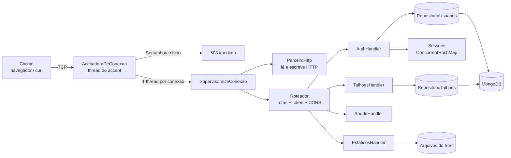

# Ofício técnico: Servidor Java manual do AgroGestão

Responsável: _(nome — RA)_
Data: 17/10/2026
Branch: `server`
Escopo do PR: novo projeto `backend/servidor/`

---

## 1. Objeto

Este documento apresenta a arquitetura do servidor HTTP do AgroGestão, construído
manualmente em Java 21 para atender à exigência da disciplina de um servidor
"feito na mão". Descreve:

- os componentes;
- o ciclo de vida de uma requisição;
- o protocolo implementado;
- o modelo de dados;
- as decisões de segurança e concorrência;
- a evidência de testes;
- o que ainda está pendente.

As instruções de uso (comandos, variáveis, exemplos com `curl`) estão em
[`backend/servidor/README.md`](../backend/servidor/README.md).

## 2. Contexto e motivação

Antes deste trabalho:

- o front (HTML, CSS e JS puros na raiz) não fazia nenhuma chamada de rede. Tudo
  era mock em JS, com persistência em `localStorage` (ver `docs/persistencia-local.md`);
- `backend/gateway` usava `com.sun.net.httpserver.HttpServer`, e `backend/core`
  era um Spring Boot vazio. Nenhum dos dois atende ao requisito de servidor manual,
  e ambos **não foram alterados**;
- não existia contrato de API. Ele foi derivado dos atributos `name` dos
  formulários (`criar-conta.html`, `login.html`, `areas-cultivo.html` etc.) e das
  validações de `scripts/auth.js` e `scripts/areas-cultivo.js`.

## 3. Requisitos atendidos

| Requisito | Como foi atendido |
|---|---|
| HTTP implementado à mão | Parse da linha de requisição, dos cabeçalhos e do corpo por `Content-Length` sobre `ServerSocket`/`Socket` (`http/ParceiroHttp.java`). |
| Sem frameworks HTTP | Nenhum uso de `HttpServer`, Spring, Netty ou Javalin. |
| Persistência em MongoDB | Driver oficial 5.13.0 (`mongodb-driver-sync`, `-core`, `bson`) como jars em `lib/`, sem Maven. |
| Front e API na mesma origem | O servidor também entrega os arquivos estáticos da raiz do repositório. |
| CORS para `localhost` | `OPTIONS` responde 204 e as origens `http(s)://localhost` ou `127.0.0.1` em qualquer porta recebem os cabeçalhos CORS. |
| Porta configurável | Argumento da linha de comando, ou `SERVIDOR_PORT`, ou 8080. |
| Encerramento controlado | Comando `desativar` no terminal. |
| Testes sem JUnit | `teste/TesteServidor.java` com `main`: 137 verificações. |
| Estilo do `backend/gateway` | Identificadores e comentários em português, chaves Allman, espaço antes dos parênteses, `throw new Exception ("... ausente")`. |

## 4. Visão geral da arquitetura



A organização segue camadas simples, sem abstrações além das necessárias:

| Camada | Pacote | Responsabilidade |
|---|---|---|
| Rede e threads | (padrão) | `Servidor`, `AceitadoraDeConexao`, `SupervisoraDeConexao` |
| Protocolo HTTP | `http` | Ler e escrever HTTP/1.x, representar requisição e resposta, rotear |
| Regras de negócio | `handlers` | Validação e casos de uso de cada rota |
| Dados | `dados` | Interfaces de repositório e implementações MongoDB e memória |
| Segurança | `seguranca` | Hash de senha e sessões |
| Utilitários | `util` | JSON e validação campo a campo |

## 5. Ciclo de vida de uma requisição

```mermaid
sequenceDiagram
    participant Cli as Cliente
    participant Ace as AceitadoraDeConexao
    participant Sup as SupervisoraDeConexao
    participant Par as ParceiroHttp
    participant Rot as Roteador
    participant Han as Handler

    Cli->>Ace: conecta
    Ace->>Ace: tryAcquire() no Semaphore (100 vagas)
    Ace->>Sup: new + start()
    Sup->>Par: lerRequisicao()
    Par-->>Sup: Requisicao (ou ErroHttp 400/413/431/501/505)
    Sup->>Rot: tratar(requisicao)
    Rot->>Rot: casa método + padrão, valida token, CORS
    Rot->>Han: tratar(requisicao)
    Han-->>Rot: Resposta
    Rot-->>Sup: Resposta (exceções viram 500)
    Sup->>Par: enviarResposta() com Connection: close
    Sup->>Sup: fecha socket, release() no Semaphore
```

1. **Aceite.** `AceitadoraDeConexao` fica em loop no `accept()`. Para cada
   cliente, tenta reservar uma vaga no `Semaphore`. Sem vaga, escreve um 503 fixo
   e fecha a conexão, sem criar thread.
2. **Supervisão.** Uma `SupervisoraDeConexao` (thread) por conexão. Ela fica
   registrada num conjunto sincronizado para que o desligamento possa aguardá-la.
3. **Leitura.** `ParceiroHttp` aplica `setSoTimeout(10 s)`, lê a cabeça até a
   linha em branco (limite de 16 KB) e o corpo exato do `Content-Length` (limite de 1 MB).
4. **Roteamento.** `Roteador` acha a rota, aplica o filtro de autenticação,
   chama o handler e acrescenta CORS e `X-Content-Type-Options: nosniff`.
5. **Resposta.** Status, cabeçalhos, `Content-Length` e `Connection: close`.
   Uma requisição por conexão, sem keep-alive, por simplicidade e previsibilidade.
6. **Liberação.** O `finally` fecha o socket, retira a supervisora do conjunto
   e devolve a vaga do `Semaphore`, sempre.

## 6. Componentes

### 6.1 Rede e ciclo de vida

| Classe | Papel |
|---|---|
| `Servidor` | `main`. Lê a configuração, cria os repositórios (MongoDB ou memória), monta o roteador, abre o `ServerSocket` e lê o terminal até `desativar`. `desativar()` fecha o `ServerSocket`, faz `join` da aceitadora, aguarda as supervisoras ativas e fecha o `MongoClient`. |
| `AceitadoraDeConexao` | Thread do `accept()` com limite de conexões por `Semaphore`. Responde 503 com `Retry-After: 1` ao exceder. |
| `SupervisoraDeConexao` | Thread por conexão. Converte qualquer falha em resposta (`ErroHttp` no status certo, timeout em 408, o resto em 500) e nunca deixa a exceção escapar. |

### 6.2 Protocolo HTTP (`http`)

| Classe | Papel |
|---|---|
| `ParceiroHttp` | Encapsula socket e streams. `lerRequisicao()`, `enviarResposta()`, `fechar()`. |
| `Requisicao` | Método, caminho decodificado, consulta, cabeçalhos (nomes em minúsculas), corpo. `getCorpoJson()`, `getToken()`, parâmetros de rota e sessão. |
| `Resposta` | Status, cabeçalhos ordenados, corpo. Fábricas `json`, `erro`, `semConteudo`, `redirecionar`. |
| `Roteador` | Tabela método + padrão (`/api/talhoes/{id}`), rotas públicas e protegidas, 405 com `Allow`, `OPTIONS`, `HEAD` e encaminhamento aos estáticos. |
| `Manipulador` | Interface funcional dos handlers (`Resposta tratar (Requisicao)`). |
| `ErroHttp` | Exceção que carrega o status HTTP. |

Regras do parse:

| Situação | Status |
|---|---|
| Linha de requisição sem exatamente 3 partes, método inválido ou alvo sem `/` | 400 |
| Versão `HTTP/x.y` diferente de 1.0 e 1.1 | 505 |
| Cabeçalho sem `:`, nome com caractere inválido ou cabeçalho dobrado | 400 |
| `Content-Length` ou `Host` duplicado | 400 |
| HTTP/1.1 sem `Host` | 400 |
| Cabeça maior que 16 KB | 431 |
| `Content-Length` não numérico | 400 |
| `Content-Length` acima de 1 MB | 413 (o corpo nem é lido) |
| Corpo menor que o anunciado | 400 |
| `Transfer-Encoding` | 501 (não suportado) |
| `%XX` inválido, UTF-8 malformado ou byte nulo no caminho | 400 |
| Sem dados por 10 s | 408 |
| Rota existente com outro método | 405 + `Allow` |
| Rota inexistente em `/api` sem token | 401 (não revela quais rotas existem) |
| Rota inexistente em `/api` com token | 404 |

### 6.3 Handlers (`handlers`)

| Classe | Rotas |
|---|---|
| `SaudeHandler` | `GET /health` (processo no ar) e `GET /ready` (ping no MongoDB: 200 UP ou 503 DOWN). |
| `AuthHandler` | `POST /api/auth/register`, `login`, `logout`, `confirm-email`, `resend-confirmation`, `forgot-password`, `reset-password` e `GET /api/me`. |
| `TalhoesHandler` | `GET /api/talhoes?cultura=&q=`, `GET /api/talhoes/resumo`, `POST /api/talhoes`, `PUT /api/talhoes/{id}`. Sem DELETE nesta entrega. |
| `EstaticosHandler` | Arquivos do front. `/` redireciona para `/login.html`. |

### 6.4 Dados (`dados`)

Cada repositório tem uma interface e duas implementações. A de memória existe
para os testes não dependerem do banco e para o modo `--memoria`.

| Interface | MongoDB | Memória |
|---|---|---|
| `RepositorioUsuarios` | `RepositorioUsuariosMongo` | `RepositorioUsuariosMemoria` (métodos `synchronized`, devolve cópias) |
| `RepositorioTalhoes` | `RepositorioTalhoesMongo` | `RepositorioTalhoesMemoria` (idem) |

`ConexaoMongo` mantém um único `MongoClient` para o processo. Ele é thread-safe
e tem pool próprio. O nome do banco vem da URI (padrão `agrogestao`).

### 6.5 Segurança e utilitários

| Classe | Papel |
|---|---|
| `seguranca.Senhas` | PBKDF2WithHmacSHA256 do JDK, 120 000 iterações, salt de 16 bytes, formato `pbkdf2$iter$salt$hash`. Comparação em tempo constante. |
| `seguranca.Sessoes` / `Sessao` | Token UUID → (usuário, propriedade, expiração de 12 h) em `ConcurrentHashMap`. `Sessao` é imutável. |
| `util.Json` | JSON só com `org.bson.Document` (`Document.parse` e `toJson` em modo RELAXED). `_id` é exposto como `id` (texto). Sem outra biblioteca JSON. |
| `util.Validacao` | Junta erros por campo e monta `400 {"error":"Validation failed","fields":{...}}` com as mesmas mensagens do front. |

## 7. Contrato da API

Os nomes dos campos JSON são os `name` dos formulários do front. Tudo sob
`/api/**` exige `Authorization: Bearer <token>`, exceto `/api/auth/*`.

### 7.1 Autenticação

| Rota | Entrada | Saída |
|---|---|---|
| `POST /api/auth/register` | `name, email, phone, password, password-confirm` (ou `confirm`), `farm, area, terms` | 201 `{usuario}` · 400 · 409 |
| `POST /api/auth/login` | `email, password` | 200 `{token, usuario}` · 401 genérico |
| `POST /api/auth/logout` | token | 204 |
| `GET /api/me` | token | 200 `{usuario, propriedade}` · 401 |
| `POST /api/auth/confirm-email` | `token` | 200 · 400 |
| `POST /api/auth/resend-confirmation` | `email` | 200 · 429 + `Retry-After` (mínimo de 30 s entre envios) |
| `POST /api/auth/forgot-password` | `email` | 200 sempre (não revela se o e-mail existe) |
| `POST /api/auth/reset-password` | `token, password, password-confirm` | 200 · 400 (token inválido, vencido ou já usado) |

Validações do cadastro, espelhando `scripts/auth.js`:

- campos obrigatórios sem espaços nas pontas;
- e-mail válido, normalizado em minúsculas e único;
- senha com ≥ 8 caracteres, 1 maiúscula `[A-ZÀ-Ý]`, 1 dígito e 1 símbolo `[^A-Za-zÀ-ÿ\d]`;
- confirmação igual à senha;
- telefone `(DD) 9XXXX-XXXX`;
- `terms` igual a `true`, `"true"` ou `"on"`.

O e-mail é **simulado**: os tokens de confirmação e redefinição são impressos no
console do servidor. O token de redefinição vale 30 minutos e é de uso único. A
redefinição encerra todas as sessões do usuário.

### 7.2 Talhões

| Campo | Regra |
|---|---|
| `nome` | Obrigatório, até 80 caracteres, único por propriedade sem diferenciar maiúsculas |
| `cultura` | Soja, Milho, Trigo, Café ou Algodão |
| `hectares` | Número > 0 (até 1 000 000). Texto é recusado. |
| `status` | Ativo, Irrigação pendente ou Em preparo. Padrão: Ativo. |

O resumo devolve `{totalHectares, quantidadeTotal, quantidadeAtivos}` da
propriedade inteira, sem aplicar filtros. A busca `q` compara com o nome em
minúsculas. O filtro `cultura` não diferencia maiúsculas, e `todos` significa
sem filtro, como nos chips do front.

## 8. Modelo de dados (MongoDB)

| Coleção | Campos | Índices |
|---|---|---|
| `usuarios` | `_id`, `name`, `email`, `phone`, `senhaHash`, `emailConfirmado`, `tokenConfirmacao`, `ultimoEnvioConfirmacao`, `tokenRedefinicao`, `redefinicaoExpiraEm`, `propriedadeId`, `criadoEm` | único em `email`; simples em `tokenConfirmacao` e `tokenRedefinicao` |
| `propriedades` | `_id`, `farm`, `area`, `criadaEm` | — |
| `talhoes` | `_id`, `propriedadeId`, `nome`, `nomeNormalizado`, `cultura`, `hectares`, `status`, `criadoEm`, `atualizadoEm` | único em `(propriedadeId, nomeNormalizado)` |

- **Isolamento por propriedade.** Toda consulta e atualização de talhão filtra
  por `propriedadeId` da sessão. Um talhão de outra propriedade responde 404,
  sem revelar que existe.
- **Unicidade garantida pelo banco.** Os índices únicos tratam as corridas entre
  requisições simultâneas. A duplicidade (`DUPLICATE_KEY`) vira 409.
- **Ordem de gravação no cadastro.** O usuário é inserido antes da propriedade.
  Se o e-mail já existir, nenhuma propriedade órfã é criada.
- **O que nunca sai na resposta.** `senhaHash`, tokens, `propriedadeId` do talhão
  e `nomeNormalizado`. A saída do usuário é montada por lista de permissão.

## 9. Segurança

| Ameaça | Medida |
|---|---|
| Vazamento de senha | PBKDF2 com salt aleatório; o hash nunca é serializado |
| Enumeração de usuários | Login devolve 401 genérico e faz um hash falso quando o e-mail não existe (tempo semelhante); `forgot-password` sempre devolve 200 |
| Acesso indevido a dados | Filtro de token no roteador e filtro por propriedade em toda consulta |
| Path traversal nos estáticos | Bloqueio de `..`, `\`, `:`, `~` (nome curto do Windows), `//`, segmentos iniciados por ponto ou terminados em ponto/espaço; `normalize()` + `startsWith(raiz)` + `toRealPath()` contra links simbólicos |
| Exposição de arquivos sensíveis | Lista de permissão de extensões (html, css, js, jpg, png, svg, ico, woff2); `.env*`, `.git` e `backend/` bloqueados (também em outras caixas, como `Backend/`) |
| Esgotamento de recursos | Cabeça ≤ 16 KB, corpo ≤ 1 MB, timeout de 10 s, até 100 conexões simultâneas |
| CORS aberto | Só `localhost` e `127.0.0.1`, com `Vary: Origin` |
| Sniffing de tipo | `X-Content-Type-Options: nosniff` em todas as respostas |
| Vazamento de erro interno | Exceções viram `500 {"error":"Internal server error"}`; o detalhe vai só para o log do servidor |
| Reuso de token | Os tokens de confirmação e de redefinição são apagados ao serem usados |

O servidor escuta em `127.0.0.1` por padrão (`SERVIDOR_HOST`), adequado ao
ambiente de desenvolvimento. Não há TLS: em produção ele deveria ficar atrás de
um proxy HTTPS.

## 10. Concorrência

| Estado compartilhado | Proteção |
|---|---|
| Vagas de conexão | `Semaphore` (`tryAcquire` na aceitadora; `release` no `finally` da supervisora) |
| Supervisoras ativas | `Collections.synchronizedSet`; cópia sob `synchronized` para aguardar no desligamento |
| Sessões | `ConcurrentHashMap`; `Sessao` imutável |
| Repositórios em memória | Métodos `synchronized` e cópias defensivas dos `Document` |
| Repositórios MongoDB | `MongoClient` thread-safe + índices únicos |
| Tokens de e-mail e senha | Bloco `synchronized` no `AuthHandler` para operações de ler e depois gravar (reenvio com intervalo, confirmação, redefinição) |
| Rotas e configuração | Montadas antes de `start()` e só lidas depois |

## 11. Evidência de testes

`backend/servidor/testar.bat` (ou `testar.sh`) compila e executa
`teste/TesteServidor.java`. O teste sobe o servidor real numa porta livre, com
repositórios em memória, e faz requisições HTTP reais por socket, inclusive
requisições malformadas que um cliente HTTP comum não enviaria.

Resultado na data deste documento: **137/137 testes ok**.

| Grupo | Exemplos de casos verificados |
|---|---|
| Parse HTTP | 400 (lixo, sem Host, cabeçalho inválido, `Content-Length` inválido ou duplicado, corpo incompleto, `%zz`, JSON inválido); 413; 431; 501; 505; 404; 405 + `Allow`; HEAD; OPTIONS/CORS |
| Estáticos | Tipos de conteúdo; bloqueio de `../`, `%2e%2e`, `..\`, `.env`, `.env.example`, `.git`, `.gitignore`, `backend/`, `Backend/`, `BACKEN~1`, `.md`, `.yaml`, ponto final |
| Cadastro | Cada validação; e-mail duplicado em outra caixa (409); aceite de `confirm` |
| Sessão | 401 genérico idêntico; login, `/api/me` e logout; token falso |
| E-mail e senha | Confirmação e reuso; reenvio em menos de 30 s (429) e depois disso; redefinição com senha fraca, confirmação diferente, token errado, vencido e reutilizado; queda das sessões antigas |
| Talhões | Validações; CRUD; filtros; resumo; nome duplicado; isolamento entre dois usuários (listar e editar) |
| Concorrência e erros | 50 requisições paralelas; 20 cadastros simultâneos com o mesmo e-mail (1 criado, 19 conflitos); 20 talhões simultâneos com o mesmo nome (1 criado, 19 conflitos); exceção em handler (500 e o servidor segue no ar); clientes que desconectam no meio; limite de conexões (503) e liberação; `desativar` fecha a porta |

Verificação manual feita em modo memória, na porta 8080:

- fluxo `curl` de cadastro → login → POST, PUT e GET de talhões → resumo;
- `login.html` e `areas-cultivo.html` abertas no navegador pelo servidor, com
  todos os CSS e JS locais respondendo 200 e sem erros no console;
- encerramento com `desativar` limpo.

## 12. Pendências e limitações conhecidas

| Item | Situação |
|---|---|
| **Validação com MongoDB real** | `backend/servidor/testar-mongo.sh` valida cadastro, índice único e criação transacional contra o banco `agrogestao_teste`. Requer `docker compose up -d mongo`. |
| Integração do front | Fora deste PR. Os scripts continuam com mocks e `localStorage`. |
| Demais módulos | Atividades, Insumos, Ocorrências, Custos, Dashboard, Notificações e Configurações ficam para as próximas entregas. |
| Sessões em memória | Reiniciar o servidor desloga todos (aceitável nesta fase). |
| Keep-alive e `chunked` | Não suportados de propósito (uma requisição por conexão). |
| Campo `area` | Guardado como texto livre ("150 hectares"), como vem do formulário. |
| Telefone fixo | Recusado. Só celular `(DD) 9XXXX-XXXX`, conforme a especificação. |

## 13. Arquivos incluídos no PR

```
backend/servidor/
  README.md                       instruções de uso
  .gitignore                      ignora bin/
  compilar.sh  compilar.bat
  rodar.sh     rodar.bat
  testar.sh    testar.bat
  lib/bson-5.13.0.jar
  lib/mongodb-driver-core-5.13.0.jar
  lib/mongodb-driver-sync-5.13.0.jar
  src/Servidor.java
  src/AceitadoraDeConexao.java
  src/SupervisoraDeConexao.java
  src/http/{ParceiroHttp, Requisicao, Resposta, Roteador, Manipulador, ErroHttp}.java
  src/handlers/{AuthHandler, TalhoesHandler, EstaticosHandler, SaudeHandler}.java
  src/dados/{RepositorioUsuarios, RepositorioUsuariosMongo, RepositorioUsuariosMemoria,
             RepositorioTalhoes, RepositorioTalhoesMongo, RepositorioTalhoesMemoria,
             ConexaoMongo}.java
  src/seguranca/{Senhas, Sessoes, Sessao}.java
  src/util/{Json, Validacao}.java
  teste/TesteServidor.java
docs/servidor-java.md             este documento
```

Nenhum arquivo do front, de `backend/gateway` ou de `backend/core` foi alterado.

## 14. Como revisar

1. `backend\servidor\testar.bat`: deve terminar em `137/137 testes ok`.
2. `backend\servidor\compilar.bat` e `rodar.bat --memoria`; abrir
   <http://localhost:8080> e seguir o roteiro com `curl` do README.
3. Com Docker: `docker compose up -d mongo`, depois `rodar.bat`. Repetir o
   roteiro, reiniciar o servidor e confirmar que os talhões continuam lá.
4. Pontos de leitura sugeridos: `http/ParceiroHttp.java` (protocolo),
   `http/Roteador.java` (rotas e autenticação), `handlers/EstaticosHandler.java`
   (bloqueios) e `handlers/AuthHandler.java` (regras de conta).
